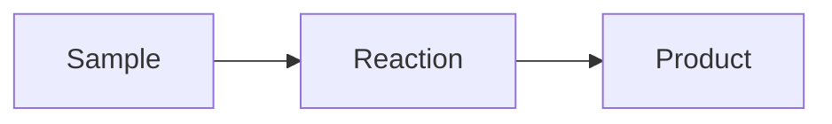

# pdfmd

[](https://github.com/aliperdehan/pdfmd/actions/workflows/publish.yml) [](https://pypi.org/project/pdfmd-cli/)

**One command from Markdown to a good-looking PDF.** `pdfmd` wraps
[Pandoc](https://pandoc.org) and fills in everything you would otherwise
have to remember: sensible fonts and margins, the right Markdown dialect,
your project's metadata/preamble/filter files, and a fallback chain across
every PDF engine you have installed. The same document also builds to a
Word or OpenDocument file that follows its page setup, fonts and LaTeX (see
[Word and OpenDocument output](#word-and-opendocument-output)).

```console
$ pdfmd lecture
FOUND     metadata: metadata.yaml + preamble.tex
DEFAULTS  margin 1in, font STIX Two Text, code in JetBrains Mono, title from heading
AUTO: READER. Use --verbose to see in full
OK    lecture.md > lecture.pdf  (lualatex)
```

`FOUND` is what pdfmd picked up from the folder, `DEFAULTS` what it applied because nothing said otherwise
(the global metadata of `pdfmd --setup`, the title taken from a leading `# ` heading, a wide table whose columns it
balanced), and the `AUTO:` line the other decisions it made. Files of one folder are listed under it once
(`metadata: metadata.yaml + preamble.tex`; `--setup` can list each with its path instead). Each line is cut at the
width of the terminal (110 characters when the output is piped): `+3 more (--verbose)`. `--verbose` prints every
decision with its reason. The closing line names the file the build made, `OK    lecture.md > lecture.pdf`; `--setup`
sets what stands between the two.

In a folder with a single Markdown file you do not even need the name: `cd` into the folder and run `pdfmd`. It finds
the file, its metadata, preamble and filters, and writes the PDF beside it (with several Markdown files it asks for
one, or for `-b` to convert all of them or `-r` to join them). `pdfmd --help` is one short page; `pdfmd --help all`
is the complete option list and `pdfmd --help tables` (or `source`, `history`, `output` ...) one subject at a time.

<p align="center">
  
</p>

That PDF came from [`examples/lecture.md`](https://github.com/aliperdehan/pdfmd/blob/main/examples/lecture.md), a plain
Markdown file with no front matter and no configuration. Plain `pandoc
lecture.md -o lecture.pdf` doesn't even get that far: its default engine,
`pdflatex`, stops at the `Δ` on line 5 with an error. With a Unicode engine
it would build, but with wide default margins, and with the `# Title`
line as an ordinary section heading instead of a title.

## Why

Pandoc can do nearly anything, but its defaults assume you'll pass the right
flags every time. In practice that means one of two things: a long command
you copy from an old shell history, or a Makefile in every folder. `pdfmd`
turns that knowledge into defaults:

- **It decides per document, not globally.** A file with no YAML front
  matter is treated as ordinary GitHub-flavoured Markdown. A file that has
  front matter is assumed to be written for Pandoc and is left alone.
- **It finds your project files.** A `metadata.yaml`, `preamble.tex` or
  `<name>.lua` beside the document (or in a `metadata/` folder next to it)
  is picked up automatically, so every document in a folder shares one
  house style without any flags.
- **It doesn't give up on the first engine.** If `lualatex` fails or isn't
  installed, it tries the next engine, then the next, and tells you why each
  one failed.
- **It writes real Word files.** `pdfmd report -o report.docx` reads the front matter the PDF reads (paper size,
  margins, fonts, line spacing) and writes it into the file's page setup and styles, so the Word file is laid out the
  way the PDF is. With LaTeX installed, what only LaTeX can say in the document comes along: `\ce{...}` chemistry,
  `\SI{...}{...}` units and equations become native, editable Word text and equations; a house style's own macros can be
  given a Word recipe; what is left (tikz, chemfig, math Pandoc cannot convert) is drawn by LaTeX in the document's
  own preamble and embedded as vector pictures. `pdfmd-options: {office: {latex: auto|images|off}}`, `--no-auto
  officelatex` and `pdfmd --setup` switch it (see [Word and OpenDocument output](#word-and-opendocument-output)).
  The file's properties hold the document's title and authors, and nothing of the machine that built it.
- **It handles every script and emoji.** Text the main font cannot draw (Arabic,
  Hebrew, Chinese, Japanese, Korean, Greek, Cyrillic with Kazakh letters, Indic and
  more) is set run by run in an installed font for its script, emoji become colour
  pictures, and `pdfmd --install fonts` fetches missing fonts without admin rights
  (see [Other scripts](#other-scripts)).
- **It finds documents by name, in any script.** `pdfmd glyukoza` opens
  `Глюкоза.md`; with `--translit` packs, `pdfmd tyche` finds `Τύχη.md` and
  `pdfmd mingyun` finds `命運.md`.
- **It reads PDFs too.** `pdfmd paper.pdf` restores a PDF's own embedded source or
  OCRs the pages to Markdown (see [PDF to Markdown](#pdf-to-markdown)).
- **Tables can be data.** A `::: {.csv}` block puts a table's data in a CSV file or right in the document (any
  delimiter, alignment and widths as attributes), and `pdfmd --extract-tables` turns the tables you already have into
  such blocks after checking that Pandoc reads the same tables back (see [Tables straight from a CSV
  file](#tables-straight-from-a-csv-file)). A table that is too wide gets its columns sized by their content.
- **Long code wraps, SVG and web images work.** Code lines wrap at the margin in a LaTeX build, an SVG is converted for
  LaTeX with whatever is installed, and an image from the web is fetched once and kept.
- **Finished files are not rewritten.** A `.typ` file goes to Typst and an `.html` file to WeasyPrint or a browser, so
  the page setup, styles and scripts survive; `--hybrid` makes the PDF open in LibreOffice as an editable document.
- **It keeps the history.** `pdfmd --history` lists the backups, commits and compiles of a file, `--history-restore`
  puts a version back (backing up the one it replaces), and the build history can live in a `.hst` file instead of the
  document (see [Build stamps, history and snapshots](#build-stamps-history-and-snapshots)).
- **It shows what it did.** Every automatic decision prints an `AUTO` line,
  `-v` shows the exact Pandoc command, and every default can be switched off.

## Install

```sh
pipx install pdfmd-cli
```

That puts a `pdfmd` command on your PATH, with its Python dependencies, in
its own isolated environment. The same with uv:

```sh
uv tool install pdfmd-cli        # install; update with: uv tool upgrade pdfmd-cli
uvx --from pdfmd-cli pdfmd file.md   # or run once without installing
```

On macOS, Homebrew installs it together with Pandoc and Typst, so nothing else
is needed for a first PDF:

```sh
brew install aliperdehan/tap/pdfmd
```

To update later, run `pipx upgrade pdfmd-cli`. (The package is named
`pdfmd-cli` because `pdfmd` on PyPI is an unrelated PDF-to-Markdown tool.
The command is still `pdfmd`. For the latest unreleased code, use `pipx
install git+https://github.com/aliperdehan/pdfmd`.)

For the full pipeline, `pdfmd` drives programs that pip can't install, so you
also need (without them it still makes a plain PDF; see
[No Pandoc?](#no-pandoc-the-built-in-fallback) below). The quickest way, with no
admin rights, is `pdfmd --install full`, which puts Pandoc and Typst in pdfmd's own
folders; the system installers below do the same job:

- **[Pandoc](https://pandoc.org/installing.html)**
- **at least one PDF engine**. [Typst](https://typst.app) is the quickest
  start; a TeX distribution (MacTeX, TeX Live) gives the best results and
  is what you need for LaTeX packages and math-heavy documents.

```sh
brew install pipx pandoc typst              # macOS, the quick start
brew install --cask mactex-no-gui           # optional: full LaTeX (large)
```

```sh
sudo apt install pipx pandoc texlive-xetex  # Debian/Ubuntu
sudo dnf install pipx pandoc texlive-xetex  # Fedora (add Typst with `pdfmd --install typst`)
sudo pacman -S python-pipx pandoc-cli typst texlive   # Arch
```

On any Linux, `pdfmd --install full` (Pandoc and Typst) needs no package manager and no root.

The extras that are Python packages (`pdfmd --install math`, `tui`, `translit`, `batchocr` ...) go into the Python pdfmd runs
from; when that Python is managed by the system (Homebrew's, Debian's: "externally-managed-environment", PEP 668) pdfmd puts
them in its own folder instead, `~/.local/share/pdfmd/python/3.14` (one per Python version), which it adds to the end of
the module path when it starts. Nothing is installed into the system's Python.

```powershell
py -m pip install --user pipx; py -m pipx ensurepath          # Windows
winget install --id JohnMacFarlane.Pandoc; winget install --id Typst.Typst
```

Every push is tested on Windows, macOS and Linux (Pandoc + Typst: single
files, CSV tables, a book, HTML output); see the
[Test and publish workflow](https://github.com/aliperdehan/pdfmd/actions/workflows/publish.yml).
LaTeX engines aren't part of that automated test on Windows yet.

Optional extras: [Quarto](https://quarto.org) for `.qmd` files,
`pandoc-crossref` for `@fig:`/`@tbl:` references, and LibreOffice for
Office files.

<details>
<summary>Without pipx</summary>

`pdfmd.py` needs Python 3.9+ and runs straight from a clone, with the folders beside it
(`pdfmd_inkmd/` for the no-Pandoc fallback, `pdfmd_office/`, `pdfmd_setup/`, `pdfmd_unicode/`). It also runs
directly, and `pyyaml`/`pypdf` are optional (features that need them are
skipped with a warning):

```sh
git clone https://github.com/aliperdehan/pdfmd.git ~/pdfmd
echo 'alias pdfmd="python3 ~/pdfmd/pdfmd.py"' >> ~/.zshrc   # or ~/.bashrc
```

macOS's built-in `/usr/bin/python3` is 3.9, which is too old; pdfmd says
so and exits.
</details>

Check what `pdfmd` can find on your system:

```console
$ pdfmd --check-dependencies
OK    pandoc  (/opt/homebrew/bin/pandoc)
OK    1. lualatex  (/Library/TeX/texbin/lualatex)
OK    2. xelatex  (/Library/TeX/texbin/xelatex)
OK    3. pdflatex  (/Library/TeX/texbin/pdflatex)
OK    4. latexmk  (/Library/TeX/texbin/latexmk)
OK    5. tectonic  (/opt/homebrew/bin/tectonic)
OK    6. typst  (/opt/homebrew/bin/typst)
OK    7. weasyprint  (/opt/homebrew/bin/weasyprint)
MISS  8. wkhtmltopdf
...
OK    14. soffice  (/Applications/LibreOffice.app/Contents/MacOS/soffice)
OK    calibre (only when named: -e calibre)  (/opt/homebrew/bin/ebook-convert)
OK    quarto (only needed for .qmd files)  (/usr/local/bin/quarto)
```

The numbers are the fallback order, and also shortcuts: `-e 6` means
`-e typst`.

**An order of your own.** `-e` takes a comma list, tried in the order written and nothing else:
`-e typst,calibre,lualatex` tries Typst, then Calibre, then LuaLaTeX. A word is an engine (or its alias), a family
(`tex`, `html`, `typst`: its installed members, in place) or `pandoc` (every engine Pandoc drives; never Calibre). A word
whose engine is not installed is passed over with a NOTE while another one of the list can run, and the build stops only
when none can. `pdf-engine:` in `pdfmd-options`, the front matter, a metadata file or the config takes the same list
(`pdf-engine: [typst, lualatex]`). Without `-e` the chain is the numbered one above, unchanged.

`-e calibre` prints the document with [Calibre](https://calibre-ebook.com)'s `ebook-convert`
instead: Pandoc writes one HTML page (math as MathML, which Calibre draws with its own
MathJax) and Calibre turns it into a PDF with the document's paper, margins, `fontsize:` and
language, page numbers, and bookmarks from the headings. LaTeX in the document is made native
or drawn as a picture, as for a Word file. Calibre is not in the numbered chain: it comes first when you
name it (`-e calibre`, or `pdf-engine: calibre` in `pdfmd-options:`), and (v3.29.1) it and the browsers
(`-e edge`, `chrome`, `chromium`, `brave`: Pandoc's HTML page, printed headless) are tried last when no engine is named
and LaTeX, Typst and the HTML engines have all failed, ahead of LibreOffice; `--doctor` lists them as last resorts.
A comma list of your own never adds them (`-e pandoc` is every engine Pandoc drives, not these).

With no Pandoc at all, Calibre reads the Markdown itself (v3.29): its own Markdown reader (tables, footnotes, fenced code, lists)
prints it, before the rough built-in renderers, with the document's paper and margins. It has no math (formulas are text) and
none of Pandoc's syntax, and says so (`NOTE`, `WARN`). `-e calibre` or `-e native` without Pandoc picks it; with Pandoc,
`-e calibre` is the HTML route above.

`pdfmd --install calibre` (v3.29) gets Calibre when it is missing (190 to 360 MB). In a terminal on a Mac or Windows it offers
`brew install --cask calibre` or `winget install --id calibre.calibre -e` first. Otherwise (or on answering `d`) pdfmd downloads the
release file for your machine and checks it against the SHA-256 GitHub lists for it, and refuses a download whose checksum is not
listed: on macOS it opens the disk image read-only and copies `calibre.app` into `~/Applications`, on Linux (x86-64, ARM)
it unpacks the archive into pdfmd's data folder (no root, no desktop entries), and either way runs `ebook-convert --version`
to check. Windows: `winget`, or the installer from calibre-ebook.com. Calibre is a program pdfmd runs, never one it contains.

A browser prints a Markdown document too (v3.29): `-e edge`, `-e chrome`, `-e chromium` or `-e brave` (or `-e browser` for the
first one installed) has Pandoc write one self-contained HTML page and the browser, headless, print it with the document's
paper and margins (`papersize`, `geometry`, `margin`: as `@page`) and 12pt text. The math is MathML, which the browser draws
itself; LaTeX in the document is made native or drawn as a picture, as for a Word file. Like Calibre, a browser comes first when you
name it and last when you do not (see above); an `.html` file already goes to one first when it has scripts or MathML.

Calibre also writes ebooks (v3.29): `pdfmd book.md -o book.azw3` (or `--to azw3`) has Pandoc write an EPUB 3 (chapters,
contents, the metadata, the math as MathML) and Calibre turn it into the target, `book.azw3` beside the document. The
twelve targets only Calibre writes are `azw3`, `mobi`, `kepub`, `lit`, `lrf`, `pdb`, `rb`, `snb`, `tcr`, `pmlz`, `htmlz`
and `txtz`; each was converted back to text to check that its words, list and table are there. (Before v3.29 `-o
book.azw3` wrote a PDF under that name.) `epub`, `docx`, `rtf`, `txt` and `fb2` Pandoc writes itself, with more of its own
features (styles, tables, footnotes); they go through Calibre only when `-e calibre` is on the command line (a
`pdf-engine: calibre` is a PDF setting), with a NOTE. `-e calibre` with another target (`.tex`, `.html`, `.md`) stops and
lists what Calibre writes. One document at a time, not `-b` or `-r`.

The math of an ebook: a Kindle or a Kobo does not draw MathML, and a MOBI has no place for it. `azw3`, `mobi`, `kepub`, `lit`
and `lrf` (and `docx` through Calibre) get each formula drawn by LaTeX as a picture, in the document's own preamble and with
its `\ce` and siunitx, as a Word file's pictures are (needs a LaTeX engine and Poppler's `pdftocairo`); the plain formats
(`pdb`, `rb`, `snb`, `tcr`, `pmlz`, `txtz`, `rtf`, `txt`, `fb2`) get the formulas as text, the simple ones with their
superscripts and the rest as TeX, with one `WARN` that counts them, and so does a picture target on a machine with no LaTeX.
`epub` and `htmlz` keep the MathML. A `--mathml` or `--math-method` of your own is kept.

An ebook can be the input too (v3.29): `pdfmd book.epub` builds `book.pdf` beside it, `pdfmd book.mobi -o book.md` writes its
Markdown (with its pictures in `media/`) for you to edit, `pdfmd book.azw3 --to docx` a Word file. An EPUB is read by Pandoc;
`mobi`, `azw`, `azw3`, `azw4`, `kepub`, `lit`, `lrf`, `pdb`, `prc`, `chm`, `snb`, `tcr`, `rb`, `pmlz`, `htmlz` and `txtz` first go
through Calibre's `ebook-convert` into an EPUB (Calibre is needed for those, not for an EPUB). The closing line names the
book. One book at a time, not with other files, `-b` or `-r`; a book with DRM, and an ebook of nothing but pictures (a comic),
cannot be read. A formula a MOBI holds as a picture stays a picture. Calibre's own scaffolding in the converted book (an
anchor for every file it split the book into, its page-break divs and classes) is dropped from the Markdown; with
`-o book.md` the pictures are copied to a `media/` folder beside it.

LibreOffice writes what Pandoc cannot too (v3.29): `pdfmd letter.md -o letter.doc` (Word 97) has Pandoc write the Word file (the
same one `-o letter.docx` writes: your reference document, native equations and tables, pictures for what LaTeX alone can draw)
and headless LibreOffice turn it into `.doc`. `rtf`, `odt`, `txt` and `epub` go through LibreOffice only with `-e soffice` (or
`-e libreoffice`, `-e office`) first on the command line, with a NOTE; without it Pandoc writes them from the document itself,
which is the better file. `-e soffice` with another target (`.tex`, `.md`) lists what it writes.

For everything at once, `pdfmd --doctor` is one page on the Markdown-to-PDF tools, fonts
and emoji, PDF reading (batchocr, Tesseract, Poppler, OCR languages), your config file and
the cache, ending with the command that fixes each missing piece:

```console
$ pdfmd --doctor
...
Reading PDFs (PDF to Markdown):
OK    batchocr 1.2.5
MISS  tesseract: not found
MISS  poppler: not found

1 thing(s) to fix:
  1. tesseract (scanned PDFs) and poppler (scanned PDFs)
       brew install tesseract poppler
```

"Installed" is not "works": a LaTeX engine can be on the PATH and still fail on a missing package or font.
`pdfmd --doctor --deep` also builds a small page (maths, code, a table) with every engine it found, by running pdfmd
itself in a scratch folder, and says which one built it and how long that took, or why it could not:

```console
$ pdfmd --doctor --deep
...
Smoke test (a small page with maths, code and a table, built with each engine):
OK    lualatex: built a PDF in 8.7 s
MISS  xelatex: could not build it (! LaTeX Error: File `stix2.sty' not found.)
OK    typst: built a PDF in 1.1 s
```

The last resorts are tried too (v3.29): an installed browser (`edge: built a PDF in 6.1 s`) and Calibre, which also writes a small
ebook (`calibre:azw3: built an AZW3 ebook in 18.0 s`), so a missing Qt library shows here and not in the middle of a book.
It takes a few seconds per engine (a minute or more if TeX has to fetch packages); without `--deep` nothing is built.

### The documents of your version: `pdfmd --doc`

`pdfmd --doc` lists the documents that came with the pdfmd you have, offline: `readme` (the manual), `recipes` (worked
examples), `agents` (a short guide for a program or an AI assistant that runs pdfmd) and `changelog`. `pdfmd --doc readme`
opens a web page of one in your browser (made once per version by Pandoc, kept in the cache); when the output is not a
terminal, or with `--print`, it prints the Markdown instead, which is what a script or an assistant wants. `--doc readme 3`
shows the third `##` section of it, `--doc readme tectonic` the first whose title has that word, `--doc search stamp history`
the headings and lines that have every word (`agents: Running without a person > ... (line 41): ...`), and `--path` says where
the file is. They are the documents of this version, copied into the package when it is built; a checkout reads the originals,
and a zipapp has none (it says where they are online).

### Tab completion

`pdfmd --completion bash|zsh|fish` prints a completion script, generated from the command
line itself so it never goes out of date:

```sh
pdfmd --completion zsh > ~/.zfunc/_pdfmd                              # ~/.zfunc in $fpath, then compinit
pdfmd --completion bash > ~/.local/share/bash-completion/completions/pdfmd
pdfmd --completion fish > ~/.config/fish/completions/pdfmd.fish
```

### An older Pandoc, and a machine with no network

The oldest Pandoc `pdfmd` is tested with is **3.1.3** (what the claude.ai sandbox has); the whole test suite runs against
it. An older one may work, and the first build with it says so once; `pdfmd --doctor` lists what a given Pandoc does
without. With 3.1.3: a numbered equation in a Word file
sits in a plain table instead of a borderless one (before 3.4), and `--extract-tables` leaves a table whose caption has
a `{#tbl:id}` (before 3.8.2: Pandoc reads that as words, so the change could not be checked). A `pandoc-crossref` must be
the release built for the Pandoc you run; one built for another is not run, with a warning, because it would put `??` where
the numbers go.

Where `pip install pdfmd-cli` cannot reach the network (a sandbox with no DNS that only takes an upload), two ways:

```sh
python3 scripts/build_zipapp.py          # on a machine with pdfmd's source: dist/pdfmd.pyz, 1.4 MB, PyYAML and pypdf inside
python3 pdfmd.pyz report.md              # on the other: needs Python 3.9+, Pandoc and a PDF engine; unpacks itself once
                                         # into ~/.cache/pdfmd/pyz/ because Pandoc has to open the Lua filters as files

pip download pdfmd-cli -d wheelhouse     # or: a folder of wheels, carried over
pip install --no-index --find-links wheelhouse pdfmd-cli
```

### No Pandoc? The built-in fallback

On a machine with no Pandoc, or Pandoc but no PDF engine, `pdfmd` does not
stop: it builds a plain PDF with a pure-Python renderer that `pip` installed
with it, and says so.

```console
$ pdfmd notes.md
NOTE  Pandoc was not found: building with the built-in renderer (inkmd). The output is plain ...
NATIVE  notes.md via inkmd
WARN  native (inkmd): notes.md: 2 math expression(s) set as plain text (Unicode, sub/superscripts, display math centred); ...
OK    notes.md > notes.pdf
```

- **[inkmd](https://github.com/eagredev/inkmd)**, written by Dylan Moir (MIT
  licence), is built in (a copy is vendored in `pdfmd_inkmd/`, about 2 MB,
  standard library only, works offline, same input gives the same bytes). It reads
  GitHub-flavoured Markdown: headings, emphasis, lists, task lists, tables,
  code blocks, quotes, links, images, and PNG/JPEG. It cannot typeset math,
  so formulas are set as readable text instead: Greek letters and operators
  as Unicode, `x^2` and `x_i` as super/subscripts, `\frac{a}{b}` as `a/b`,
  and display math (`$$...$$`, `\begin{equation}`, `aligned`) as its own
  centred lines. No bookmarks, no page numbers.
- **md2pdf** ([pymd2pdf](https://pypi.org/project/pymd2pdf/), ReportLab based) is
  used when installed, for documents with footnotes, math or a title:
  `pdfmd --install math` (same as `pip install "pdfmd-cli[math]"`; about
  150 MB, Python 3.11+, installs matplotlib so formulas render offline, centred,
  as real math; the few matplotlib cannot read are set as text like inkmd's).
  Footnotes, bookmarks and syntax-highlighted code come with it.
- `pdfmd --install emoji` (about 11 MB; `pdfmd-cli[emoji]` is the pip way for the
  built-in renderer only) puts the colour emoji font in pdfmd's own fonts folder,
  where the built-in renderer and every engine that can draw colour emoji
  (Typst) find it; without it emoji print as `[rocket]`-style labels in the
  built-in renderer.
- `pdfmd --install math:mathjax` (MathJax 4 and its STIX Two math font, about 12 MB to download, about 2 MB on
  disk) and `pdfmd --install math:katex` (KaTeX, about 1.5 MB) are for WeasyPrint's PDFs, not the built-in
  renderer: they typeset its math (see "WeasyPrint does not typeset math itself" below).
- `pdfmd --install core:tex` (also `cortex`, about 50 MB) is the other core: **Pandoc and Tectonic**, the self-contained
  LaTeX engine (its release from GitHub, checked against the SHA-256 GitHub lists, into pdfmd's own tools folder). Tectonic
  fetches the TeX files a document needs from the network the first time, then works from its cache. `core:typst`
  (or `core`) is `--install full` below. `pan-tec` (see "Other command names") runs pdfmd on it.
- `pdfmd --install full` leaves the fallback behind: it installs **Pandoc** (the
  real binary from PyPI's `pypandoc_binary`, about 35 MB, also `--install pandoc`
  / `pdfmd-cli[pandoc]`) and **Typst** (Typst's own release from GitHub, about
  15 MB, also `--install typst`, checked against the SHA-256 GitHub lists) into
  pdfmd's own folders (`~/.local/share/pdfmd/bin`, `%LOCALAPPDATA%\pdfmd\bin`),
  with no admin rights. A Pandoc or Typst already on your PATH always wins; to
  remove them, `pip uninstall pypandoc_binary` and delete the `typst` file.

Every input is treated as GitHub-flavoured Markdown. Pandoc-only syntax is
converted where possible (`\newpage` and `<!-- pagebreak -->` become a page
break, as they do through Pandoc with `pagebreak:`, see *Page breaks in every
format*; footnotes become endnotes for inkmd, `$` prices are not mistaken for math)
and removed otherwise (heading and image attributes, `:::` divs, raw LaTeX,
`<!-- comments -->`), with one warning per kind. CSV tables
(`::: {.csv file="data.csv"}`) work as they do with Pandoc. The title, author and date in the
front matter become a title block and the PDF's own title and author; other
front-matter keys (`documentclass`, `header-includes`, `pdfmd-options`) are
listed as not used. There are no filters, preambles, citations, slides, parts or
report mode, and only Markdown input: for any of those, `pdfmd --install full`
(or `brew install pandoc typst`, `winget install JohnMacFarlane.Pandoc Typst.Typst`).

The built-in renderer is chosen automatically only when there is no Pandoc
route; a Pandoc build that fails never falls back to it. Ask for it with
`-e inkmd`, `-e md2pdf` or `-e native`, or `pdf-engine: inkmd` in `pdfmd-options`.
When it runs on a terminal and had to leave something out, `pdfmd` offers the
upgrades above (set `PDFMD_NO_PROMPT=1` to silence that; choosing "don't ask
again" remembers it).

## Usage

Every command below can be run from inside [`examples/`](https://github.com/aliperdehan/pdfmd/tree/main/examples/).

### One document

```sh
pdfmd lecture                 # finds lecture.md, writes lecture.pdf beside it
pdfmd lecture.md --open       # ...and opens it when done
pdfmd ~/notes/lecture.md -d   # write the PDF into the current directory instead
pdfmd lecture -w              # watch: rebuild on every save, until Ctrl+C
```

A bare name is looked up as `<name>.md`. The name can contain dots:
`pdfmd notes-v1.2` builds `notes-v1.2.md`.

If no file has exactly that name, pdfmd also looks at what each document is
called inside: its title, and any `pdfmd-options: {alias: ...}`. Case, spaces,
`_`, `-`, accents and script don't matter (`pdfmd animportantdocument` finds
`An Important Document.md`; `pdfmd glyukoza` finds a document titled
`Глюкоза`), and a unique *start* of a name or title works too, with a warning
saying what it matched (`pdfmd animp`, `pdfmd glucose`). A name that fits two
documents is an error, never a guess; `--no-auto lookup` switches the guessing
off. An exact file name always wins.

**Names in other scripts.** Russian, Ukrainian, Belarusian and Kazakh Cyrillic are
always understood. Other scripts are off until you ask, one pack per script, so
nobody carries tables they don't use: `--translit greek,hangul` (or
`PDFMD_TRANSLIT=greek,hangul`) makes `pdfmd tyche` find `Τύχη.md` and
`pdfmd unmyeong` find `운명.md`. Built in: `greek`, `armenian`, `georgian`,
`hebrew`, `arabic` (consonants only, as the scripts write them), `hangul`
(Revised Romanization) and `kana` (Hepburn). `han` gives pinyin without tones
(`pdfmd mingyun` finds `命運.md`) and `other` covers every remaining script;
they use [pypinyin](https://pypi.org/project/pypinyin/) (MIT) and
[anyascii](https://pypi.org/project/anyascii/) (ISC), installed with
`pdfmd --install translit` (`pip install "pdfmd-cli[translit]"`; about 3 MB).
`--translit all` turns every pack on, `--translit none` even Cyrillic off,
`--translit list` shows what is ready. These are for *finding* a name: plain
letters, no tones, vowels left out where the script leaves them out. Names that
romanize alike (homophones) are listed as ambiguous, never picked between. The
same spelling rules find a section by its heading (`doc#tyche`).

### Check a document before you build it

```sh
pdfmd report --check                  # read report.md (a scaffold and its parts too) and list what is wrong; builds nothing
pdfmd a.md b.md --check               # several files, one report each
pdfmd report --check --strict         # warnings fail too (exit 1), for CI
pdfmd report --check --check-ignore heading-jump,link-missing
```

`--check` reads the source, with no Pandoc and no LaTeX, and prints compiler-style lines
(`report.md:12: error: image not found: figs/a.png  [image-missing]`) that an editor can jump to, then
`CHECK  report.md: 1 error(s), 2 warning(s)`. It exits 1 on an error, and on a warning too with `--strict`. It finds:

| check | |
|---|---|
| `image-missing`, `file-missing`, `link-missing` | an image (``, ``, `\includegraphics`), a `file=` of a `.csv` div or a link to a local file that is not there |
| `anchor-missing` | `[x](#methods)` with no heading or `{#id}` of that name (the ids Pandoc and GitHub make from a heading count) |
| `id-duplicate`, `crossref-missing`, `ref-missing` | the same `{#id}` twice; a `@fig:x`, `@tbl:x`, `@eq:x`, `@sec:x`, `@lst:x` or `\ref{x}` nothing defines |
| `cite-missing`, `cite-no-bibliography`, `bibliography-missing` | a `@key` the `.bib`, CSL JSON or `references:` lacks (with a "did you mean"), citations with no bibliography set, a bibliography file that is missing |
| `footnote-missing`, `footnote-unused` | `[^1]` with no text, a `[^1]:` nobody uses |
| `heading-jump`, `heading-space`, `heading-empty` | `#` then `###`; `#Heading` (a paragraph); a heading with no text |
| `fence-open`, `comment-open`, `div-open`, `div-stray`, `math-open` | a code fence, `<!--`, `:::` div or `$$` that is never closed, or a stray `:::` |
| `front-matter`, `front-matter-duplicate` | YAML that does not parse (with its line) or never closes; a key set twice |

Code, comments, math and URLs are not read, so `@decorator` in a code block or `me@x.org` is not a citation. A
document in parts is checked as one: a link to `#methods` in the scaffold is found in a part. A file with no front
matter is taken for a fragment and its citations are not held against a missing bibliography, and neither are those of
a document with a Lua filter or `citation-engine` (something else may do the citing). A part checked on its own cannot
see the other parts' labels, so check the scaffold, not a part, to judge links across parts.
Leave a check out for the project with `pdfmd-options: {check-ignore: [heading-jump]}` (a document, a metadata file or
the config), or on one line with `<!-- pdfmd-check: ignore image-missing -->` on it or on the line above. `pdfmd --check`
is for Markdown; the build's own `WARN` and `--strict` still catch what only a build can see.

### A small editor

```sh
pdfmd --install tui           # once: prompt_toolkit, about 1 MB
pdfmd --edit lecture          # nano-like full screen; Ctrl-B saves and builds, Ctrl-P opens the PDF
```

`pdfmd --edit` (alpha) opens the Markdown file in a plain full-screen editor with the build one key away: Ctrl-S
saves, Ctrl-B saves and builds (what pdfmd said stays at the bottom), Ctrl-P opens the result, Ctrl-W / F3 find,
Ctrl-G go to a line, Ctrl-K / Ctrl-U cut and paste a line, Ctrl-Z / Ctrl-Y undo and redo, Ctrl-X leaves (asking once
when there are unsaved changes); F1 lists them. Options given beside it (`pdfmd --edit lecture -e lualatex`) are used
for the build, and a name that does not exist yet starts a new file. It is deliberately rough: a base for what comes later.

**Edit a PDF in place.** A PDF that carries its source (`--attach-source`; `pdfmd --check-source` says which do) can be
edited and rebuilt where it lies:

```sh
pdfmd --edit report.pdf                          # the built-in editor, on the source as one file in a temporary folder
pdfmd --edit report.pdf --editor "code --wait"   # your own: the folder is watched and rebuilt on every save
```

A document is edited as the ONE file its source is: the text with its metadata, preamble, bibliography and style, and the `.tex`
and CSV files it reads, as blocks after the text (`<!-- pdfmd-at: ... -->` comments say on which line each one is); only what
is not text (your package, pictures, files in sibling folders) is beside it. You edit that file; Ctrl-B (or each save with
`--editor`) builds it, and when you leave, `report.pdf` is replaced by the rebuilt one, which carries the source again, and
the old one is kept in `.backups/` beside it. Before it is replaced pdfmd checks that the rebuilt PDF still carries its source
and everything the old one carried; a PDF without its source is refused (yours stays as it was), and what is missing is named.
The temporary folder is removed when you leave. For the files it was made from, `pdfmd --restore report.pdf` (or `--unpack`). Nothing
changes when you leave without editing, or when the last version does not build. The options of the first build are the
ones the document and its metadata record; the command-line ones are the ones you give now, and the global metadata of
`pdfmd --setup` is this machine's (a rebuild on another one can differ). A book built with `-r` is edited as a book: your editor gets every
chapter file and each save rebuilds all of them in the order the book was built (the built-in editor opens the first chapter and names the
others). `--editor CMD` also works on a Markdown file
(a watch that rebuilds on every save, until the editor closes), and `pdfmd --setup` keeps a default editor.

### In VS Code

`pdfmd --init-vscode` writes a `.vscode/tasks.json` here (build, build and open, watch, check, extract tables; Terminal > Run
Build Task). The [`vscode/`](https://github.com/aliperdehan/pdfmd/tree/main/vscode) folder of the repository is a small
extension over the same command line: build (`Cmd/Ctrl+Alt+B`), build and open, build as Word/HTML/Typst/slides, extract
tables (all, or chosen ones), file history, compare and restore, restore the source a PDF carries (right-click it). Every
command it runs is written to the *pdfmd* output panel. Install it with `npx @vscode/vsce package` and
`code --install-extension pdfmd-vscode-*.vsix`.

### A size budget for images and output

```sh
pdfmd report --max-asset-mb 5 --max-output-mb 20     # warn about an image over 5 MB and an output over 20 MB
pdfmd report --check --max-asset-mb 5                # list the images over 5 MB (asset-large), nothing is built
```

```yaml
pdfmd-options:
  max-asset-mb: 5        # one image or data file
  max-output-mb: 20      # the file that is made (a mail server's limit, a course site's upload limit)
```

There is no budget unless one is set. With one, a build says which image is over it before it starts
(`WARN  report.md: figs/scan.png is 14.2 MB, over the 5 MB asset budget`) and, when the file made is over the output
budget, names it and the three largest images behind it. They are `WARN` lines, so `--strict` fails them. `--max-asset-mb 0`
switches a document's budget off for one run.

### Start from a template

```sh
pdfmd --init                          # the templates: article, report, notes, slides, book, and yours
pdfmd --init article my-paper         # my-paper/my-paper.md + refs.bib, title, author and date filled in
pdfmd --init report .                 # into this folder, if none of its files exist yet
pdfmd --init notes week3 -V author="A. Author" -V title="Week 3"
```

Each template builds as it is (they are checked with `--check --strict` and built in the tests): an `article` with an
abstract, an equation, a table and a citation with its `.bib`; a `report` with a contents page, numbered sections and a
table read from a CSV file; `notes` (headings, math, a code block); `slides` (build with `-p`); and a `book`, a scaffold
with its chapters in `parts/`. The title comes from the name, the author from `-V author=` or `git config user.name`.
Nothing that exists is overwritten: pdfmd names the files in the way and writes nothing. Your own templates are a
folder (or a single `.md` file) in the `templates/` folder of pdfmd's config folder (`pdfmd --init` shows where), or any
folder or `.md` file named by its path. In their files and file names `{{name}}`, `{{title}}`, `{{author}}`, `{{date}}`
and `{{year}}` are replaced (`__name__.md` becomes `my-paper.md`); any other `{{...}}` stays as written. A
`description.txt` (one line, for the list) and a `next.txt` (what to type next) in a template folder are not copied.

### One section

`pdfmd doc#onlyapart` builds just the section whose heading is "Only a Part"
(down to the next heading of the same or a higher level), written as
`doc.only-a-part.pdf` beside the document. Headings are named the way files
are: case, spaces and spelling don't matter, a unique start works (with a
warning), and so does a `{#label}`. `doc##yield` asks for a level-2 heading,
`doc#results/yield` for one under another, `doc#a+b` for several, and
`pdfmd '#yield'` uses the folder's only Markdown file. `@` does the same as `#` (`doc@yield`, `doc@@yield`, `pdfmd @yield`), for the shells that read
`#` as a comment. `pdfmd doc --list-parts`
shows what can be named. In a document split into parts the same names work
for headings inside the parts.

Anything with a `{#label}` can be named too: `pdfmd doc#fig:setup` builds just
that figure, `doc#eq:energy` that equation, and likewise a table, a fenced div,
a code block or a span (the figure's number restarts at 1).

### Other output formats

The format is taken from `-o`'s extension, or given explicitly with `--to`:

```sh
pdfmd lecture -o lecture.html
pdfmd lecture -o lecture.docx
pdfmd lecture --to typst -o lecture.typ
pdfmd lecture -o lecture.tex      # a complete, compilable .tex, not a fragment
```

### Plain Markdown: `--to gfm`

```sh
pdfmd report --to gfm                # report.gfm.md, beside report.md, never over it
pdfmd report --to gfm -o README.md
pdfmd report --to gfm+raw            # Pandoc's own gfm writer, with its HTML, as it was
```

`--to gfm` writes Markdown that any viewer shows as it is (GitHub, VS Code, Obsidian, a chat window): no HTML, no
`{#id .class}` braces, no Pandoc-only syntax. pdfmd runs everything it runs for any other target first (includes, parts,
`::: {.csv}` tables, pandoc-crossref, citations, your filters), then flattens what is left:

- the title block is written (`# Title`, an `*Author, Author — date*` line, the abstract), since the front matter is not;
- a table caption becomes `**Table 1.** text` above the table, a figure caption the same below the figure (the label
  is split at the number pandoc-crossref wrote, in any language); `{#tbl:x}` and `{#fig:x}` are gone;
- `<div>`, `<span>`, `<figure>` and the bibliography's wrappers are unwrapped; section numbers (`number-sections`) are
  written into the headings; a link to a heading points at the anchor GitHub gives it, a link to a vanished id is text;
- subscripts and superscripts are Unicode where every character has one (`H₂O`, `x²`, `CO₃²⁻`) and `_(..)` / `^(..)`
  where not (`--gfm-scripts unicode`, the default; `html` keeps `<sub>`, `drop` writes the plain text, `ascii` always
  writes `_2`, `^(q+z)`); math stays `$..$` and `$$..$$` (`--gfm-math fenced` writes ```` ```math ````);
- raw HTML and raw LaTeX are read into Markdown (`<b>x</b>` becomes `**x**`, `\textbf{x}` too); a raw Typst piece, a LaTeX
  picture (`tikzpicture`, `\chemfig`, drawn with your preamble), a PDF image and an `` become SVG files in
  `<name>_files/` beside the output, linked relatively;
- definition lists become a bold term and a paragraph; a table Markdown cannot hold (spans, several header rows, block
  cells) is written as an HTML table, the one piece of HTML that stays, and counted in a `NOTE`;
- what no Markdown can carry (Word XML, a LaTeX macro nothing read) is left out, and a `WARN` counts it and shows the
  first.

```yaml
pdfmd-options:
  gfm: {scripts: unicode, math: dollars, title: true}
```

`-o notes.gfm.md` is `--to gfm` (it is also the name a flat file gets by default from `notes.md`); `-o notes.md` alone still means Pandoc's Markdown, so name the target (`--to gfm -o notes.md`) to get the flat one under that name. The paragraphs are single lines (`--wrap=none`; pass `--wrap=auto` to Pandoc to change it). Image links stay as the document wrote them, relative to the document's folder (a `NOTE` says so when the output is written elsewhere). The result is meant to be
final: what the flattening removes (ids, cross-reference numbers become text, citations become text) is not recoverable
from it.

#### The flat file that carries its source: `--keep-source`

Flattening cannot be undone (ids, cross-reference numbers, citations and scripts are text now). So a Markdown output
can end with its whole source in one HTML comment, the same set of files `--attach-source` puts into a PDF (the
assembled Markdown, a manifest of the layout, the `.csv` data), and `--restore` writes them back:

```sh
pdfmd report --to gfm --keep-source            # report.gfm.md ends with the source, compressed (packed)
pdfmd report --to gfm --keep-source readable   # the same, as escaped text you can read and diff
pdfmd --restore report.gfm.md --list           # what it carries
pdfmd --restore report.gfm.md                  # writes report.gfm.restored/ (never overwrites anything)
```

```yaml
pdfmd-options:
  keep-source: true        # or readable; --no-keep-source turns it off for a run
```

Nothing in the source can close the comment early: `packed` is base64 of the compressed source (no `-`, `<` or `>`
in it), `readable` escapes every `>` (so no `-->` or `--!>`), a backslash, a carriage return and a line-initial `<` or `=`,
and undoes it exactly. A source with `<!-- a <!-- b --> c -->`, `-->` in a code block, CRLF line endings or the marker
itself comes back byte for byte. The comment also stores a hash of the Markdown above it, so `--restore` can tell
you the file was edited since. Comments are stripped from the kept copy unless `strip-comments` says otherwise (as for
`--attach-source`); a whole build keeps its source, a part or a section built alone does not; a kept source over 1 MB
gets a warning, since GitHub stops showing a Markdown file that large. It works for every Markdown output: `--to gfm`,
`gfm+raw`, `markdown`, `commonmark`.

### Plain text: `--to txt`

```sh
pdfmd report --to txt                # report.txt; the same as -o report.txt
pdfmd report --to txt --columns=100  # Pandoc's wrapping, 72 columns unless you say otherwise
pdfmd report --to plain              # Pandoc's own plain writer, as it was
```

`--to txt` is the flat build of `--to gfm` written by Pandoc's plain writer: includes, parts, `::: {.csv}` tables,
pandoc-crossref, citations, raw HTML and LaTeX and your filters all run first. What a text file shows: the title, the
author line and the abstract, then headings underlined with `=` (level 1) and `-` (level 2) and numbered when the
document numbers its sections; `Table 1. caption` above a table and `[Figure 1. caption]` for a figure; a link as
`words <https://address>` (just the words when they are the address, or the link points into the document); no `**` or
`_`; Unicode sub/superscripts (`H₂O`, `x²`, else `_(..)` / `^(..)`; `--gfm-scripts drop` or `ascii` change that, `html`
means `unicode` here); math as Pandoc's plain writer sets it (`E = mc²`). A picture cannot be shown: its caption stands
for it, and a Typst or LaTeX picture piece is left out with a `WARN`. `pdfmd-options: {txt: {scripts: unicode, title:
true}}` holds the settings. Until 3.26.7 `--to txt` and `-o x.txt` meant Pandoc's own plain writer; that is `--to plain`.

### A number computed inside a sentence: `` `2026 - 2006`{=} ``

Inline code followed at once by a bare `{=}` is replaced by its value (3.30.4): `` `2026 - 2006`{=} `` is 20, `` `sin(30*deg)`{=} `` is 0.5.
`pdfmd_lua/calc.lua` has its own small parser (`+ - * / ^ % //`, parentheses, `pi`, `sin cos tan` and their inverses, `exp ln log sqrt`,
`round` (an exact half goes to the even digit, as in R and Python: `round(2.5)` is 2; `--calc-round away` or `pdfmd --setup` gives 3), `min max` and more; [docs/recipes.md](docs/recipes.md) 1.11 lists them) and runs nothing, so it is safe on any file. What it cannot
evaluate keeps its code, with one `WARN`. `--no-calc`, `pdfmd-options: {calc: off}` or `--setup` turns it off. Needs Pandoc.

### Read it in the terminal: `--view` and `--to ansi`

```sh
pdfmd --view report                  # styled text in the window, through a pager when it is longer
cat notes.md | pdfmd --view          # a pipe is read as Markdown (also: pdfmd --view -)
pdfmd --view a.md b.md               # one stream, a dim rule with each file's name above it
pdfmd --view                         # the Markdown files here; with none, type or paste and press Ctrl-D
pdfmd report --to ansi               # report.ansi, the same text with its escape codes (also -o report.ansi)
pdfmd report --to ansi -o - | less -R   # -o - is standard output, for any format
```

What the window shows: headings, **bold**, *italic*, `code`, ~~strike~~, links, lists with their numbers, block quotes, code
blocks, rules, footnotes at the end, and every table as a box grid (a rule between rows, a bold header, columns as wide as
their widest cell, right- and centre-aligned as the table says, cells wrapped to the window when it is narrower, wide
characters counted as two). The text is wrapped to the window's width (`--width N` for another; 120 when there is no window).
Math is text: `$\Delta G = -RT\ln K$` becomes `ΔG = − RT ln K` with the variables in italic, `Mg^{2+}` becomes `Mg²⁺`, a
fraction `(a+b)/(c+d)`; a formula on its own line is centred. A picture is `[image: alt] (path)`.

It is a build like any other, so discovery, metadata files, filters, citations and `\ce{...}` apply first (pdfmd reads
Pandoc's AST; `--to ansi` writes the result to a file, `--view` to the screen). `--view` is `--to ansi -o -` plus a pager:
`$PDFMD_PAGER`, else `$PAGER`, else `less -FRX` (it quits at once when the text fits the screen); `--no-pager`,
`pdfmd-options: {pager: false}` or a row in `pdfmd --setup` turns the pager off. The styling is kept when the output is piped
(`pdfmd --view x.md | less -R`) and removed by `--color never` or the `NO_COLOR` variable; `-o -` into a pipe is plain unless
`--color always`. A link is `words (address)`, or a clickable link in a terminal that draws them (iTerm2, WezTerm, Ghostty,
VS Code) when the text is not paged. The notes of the build (`OK`, `DEFAULTS`) stay off the screen unless it failed or you
gave `--verbose`; everything else a build prints goes to standard error, so standard output is the document and nothing
else. `--view -o x.ansi` saves the file and shows nothing; `--view` with another `--to` is refused.

Limits: a cell that spans rows or columns is drawn in its first cell only; a formula is drawn linearly (no stacked
fractions, roots or sums yet); raw LaTeX, HTML and Word pieces are left out (`--verbose` counts them); code is not
highlighted. Without Pandoc the built-in parser reads the Markdown, so no filters, citations, footnotes or metadata files.

### ASCII only: `--to ascii`

```sh
pdfmd report --to ascii               # report.ascii.txt: no byte above 127
pdfmd report --to ascii:gfm           # report.ascii.gfm.md (also ascii:markdown, commonmark, rst, org, asciidoc, plain)
pdfmd report -o notes.ascii.txt       # the name asks for it, as notes.gfm.md asks for --to gfm
pdfmd report -o notes.ascii.rst       # any text ending after .ascii: .gfm.md, .md, .rst, .org, .adoc
pdfmd report --to ascii --ascii-missing escape    # what has no ASCII form: \u65e5 instead of ?
```

For a terminal, an old mail gateway, a legacy system. The build is that of the format after the colon (`txt` when there
is none), with the words mapped to ASCII before the writer sees them, so the writer escapes what the new spelling needs:
a `−` at the start of a line that becomes `-` is written `\-`, not taken for a list; a table's columns are measured on the
ASCII text. What is mapped, in this order: punctuation and spaces (curly quotes, `—` as `--`, `…` as `...`, no-break
spaces, soft hyphens), symbols (`≤` `<=`, `±` `+/-`, `→` `->`, `°` `deg`, `½` `1/2`, `©` `(c)`), Greek letters by name
(`α` `alpha`, `Δ` `Delta`, `μm` `um`; a Greek word is spelt: `Σοφία` `Sophia`), Cyrillic with its case (`Привет`
`Privet`), accents (`é` `e`, `ß` `ss`, `ł` `l`), subscripts and superscripts (`H_2O`, `x^2`, `CO_3^(2-)`; `--gfm-scripts
drop` writes `H2O`), then the romanization packs for Hebrew, Arabic, Armenian, Georgian, Korean and Japanese kana, and
Chinese and the rest when `pypinyin` or `anyascii` is installed (`pdfmd --install translit`). Math stays TeX, with macros
(`$\alpha \geq 2$`); a link's address is percent-encoded (`%C3%A9`), not spelt. A character with no ASCII form is
counted and named in a `WARN`, and written as `?` (`--ascii-missing question`, the default), as `\uXXXX` (`escape`), as
nothing (`drop`), or the file is not written at all (`fail`); `pdfmd-options: {ascii: {missing: escape}}` sets it per
document. `--keep-source` on an ASCII file keeps the source packed (the readable form would be Unicode). It applies to text
formats only: `--to ascii:docx` is refused.

### Word and OpenDocument output

Plain Pandoc ignores `papersize`, `geometry`, `mainfont` and `fontsize` when it writes `.docx`
or `.odt`: you get a Letter page in the default fonts. pdfmd writes them into the *reference
document* Pandoc builds the file from, so the page and the text follow the same front matter as the PDF:

| Front matter | In the Word file |
|---|---|
| `papersize: a4` (also `letter`, `legal`, `a5`, `b5`..., `classoption: [a4paper, landscape]`) | page size and orientation |
| `geometry:` (a list, `margin=2cm`, `top=1in,left=...`, `paperwidth=...`) or `margin:` | page margins |
| `mainfont`, `sansfont`, `monofont`, `CJKmainfont`, `fontsize`, `linestretch`, `lang`, `indent` | body, heading and code fonts, sizes, line spacing, language, first-line indent |

A `.docx` carries font *names*, not fonts, and the person opening it has Times New Roman, not
STIX Two Text. So well-known fonts Word does not ship are mapped to the closest one it does (STIX
Two Text, Libertinus, Latin Modern to Times New Roman; Helvetica Neue, Inter to Arial; JetBrains
Mono, Menlo, Fira Code to Consolas), with an `AUTO OFFICE` note; `office: {fonts: exact}` keeps
your names. Without any of these keys pdfmd's own look applies: black bold headings sized like a LaTeX
article, a centred title block, booktabs-style table rules, Times New Roman and Consolas.

**Your own template.** A reference document decides the page and fonts itself, and pdfmd then
changes only what the document's `office:` block names. It is found, in order, as
`office: {reference-doc: FILE}`, `<name>-reference.docx` or `reference.docx` (`.dotx` works too,
`.odt`/`.ott` for ODT, `.pptx`/`.potx` for slides) beside the document, in its `metadata/` folder or
beside its metadata files, and finally in `~/.config/pdfmd/`. Pandoc's own `--reference-doc` is left
alone. Only builds whose output is `.docx`/`.odt`/`.pptx` look for one. `pdfmd --init-reference`
writes `reference.docx` (also `odt`, `pptx`): Pandoc's styles with pdfmd's look, to restyle in Word.

A template keeps its own style names. `office: {styles: {Heading1: LRH1, BodyText: LRNormal, Table: TableGrid}}`
makes the Heading 1, Body Text and table Pandoc writes look like the template's own `LR H1`, `LR Normal` and
`Table Grid` (a missing Pandoc style is created from the source); `office: {replace: {NULAB-KICKER: "Course
wording"}}` rewrites text in the template's headers and footers; `office: {title-page: true}` gives the first
page a page of its own, without header or footer.

**A LaTeX package can tell pdfmd about itself.** Beside a package's `.sty` (or in an `office/` or `pdfmd/` folder there)
pdfmd looks for `<package>-pdfmd.yaml`, and for its Word support: `<package>-reference.docx`/`.dotx`,
`<package>-office.lua` (the profile above) and `<package>-office.yaml` (the `office:` defaults, with `by-option:`
entries for what an option of `\usepackage[opt]{package}` adds). A document that loads the package gets all of it with
no setting of its own, and a package without these files behaves exactly as before.

`<package>-pdfmd.yaml` holds `latex-keys:`, the front-matter keys the package's macros are filled from
(`experiment: LabExperiment` turns `experiment: Titration` into `\renewcommand{\LabExperiment}{Titration}` after the
preamble), and an optional `office:` section, the same as `<package>-office.yaml`, for a package that wants one file:

```yaml
latex-keys:
  experiment: LabExperiment
  group: LabGroup
office:
  reference-doc: house.dotx
```

The same file can list `lua:` (Lua filters beside the document besides `<package>.lua`, which a document that loads the
package gets by name anyway), `draft-skip:` (`commands:` that take one argument and `spans:` of a start macro up to its stop
macro, which the label scan's draft pass need not draw, as it skips `chemfig`) and `picture-cache:` (the macro names and the
request-file suffix a package used for the picture cache before the protocol had neutral names, see "For a package author").
pdfmd names no package: all of this is found by reading the packages a document loads, in its preamble files or its
`header-includes:`.

```yaml
pdfmd-options:
  office:
    reference-doc: ../templates/house.dotx   # or leave it to be found
    papersize: a4                            # change just this on top of the template
    fonts: exact                             # keep STIX Two Text and friends as named
    style: plain                             # no pdfmd look (headings, title block, table rules)
```

`--no-auto officeref` turns the search off, `--no-auto officestyle` leaves Pandoc's default alone.

**LaTeX in the document.** Pandoc turns `$x^2$` into a Word equation and drops everything else of
LaTeX. For `.docx` and `.odt` pdfmd adds a filter that makes it native where it can:

- `\ce{Ag+(aq) + Cl-(aq) -> AgCl(s)}` (mhchem) and `\si{\gram\per\mole}`, `\qty{5}{\mL}`,
  `\num{1.5e-3}` (siunitx) become formatted text with real subscripts, charges and units, and, inside
  math, Word equation pieces. `\ce` is read by a port of mhchem's own parser, so it comes out as LaTeX sets it;
  siunitx follows your `\sisetup`, `\DeclareSIUnit`s and unit shortcuts, those of your own packages too. A
  formula with words over its arrow is an equation;
  the same in an HTML, EPUB, Markdown, text or Typst file and a PowerPoint deck, whose writers would drop them;
- `\begin{equation}`, `align`, `reaction`... become Word equations with their number at the right;
- raw `figure`, `tabular`, lists, `\emph`, `\newpage`... are read by Pandoc's own LaTeX reader;
- `\ref`, `\eqref`, `\cref`, `\Cref`, `\pageref` and the "Figure 3." in front of a caption use the numbers
  LaTeX itself gave (pdfmd builds the PDF once, in its cache, and reads the `.aux`; reused while the sources
  are older), with the caption separator (`labelsep=`) and `\crefname`s of your preamble. Each reference is a link
  to what it names. A `\label` in a caption, in a block drawn as a picture or on any line of an equation becomes a
  bookmark there. In OpenDocument a labelled table, figure or div, and a citation's entry in the references, get one
  too, since its writer bookmarks none of them;
- **what is left is drawn by LaTeX**: tikz, chemfig, a house style's own macros, math Pandoc cannot convert are compiled in
  *your document's own preamble* (the same fonts, packages and macros as the PDF, one fragment to a page), and the
  pages go into the Word file as vector pictures: an SVG with a 300 dpi PNG fallback (Word 2016 and later draw the SVG,
  LibreOffice and older readers the PNG). An inline fragment sits on the text's baseline, a wide one is scaled to the
  text width, a figure's caption stays text with its number. `\includegraphics{plot.pdf}` and `` (Word cannot
  show a PDF) are converted the same way. Pictures are cached by content, so a rebuild draws only what changed
  (`pdfmd --clear-cache` empties it). A fragment that will not compile is named in a warning and left out; the rest of
  the document is built. Needs `pdftocairo` (Poppler) and a LaTeX engine; without them the fragments are reported only.
- **a house style's own macros** can be told to pdfmd: `office.lua` (or `<name>-office.lua`) beside the document, in its
  `metadata/` folder or in `~/.config/pdfmd/`, or `office: {profile: FILE}`, is a small Lua file:
  `return {ignore = {"\\LabCaptionBegin"}, commands = {prelab = function(args) return {pandoc.Strong{pandoc.Str("[pre-lab " .. args[1] .. "]")}} end}}`
  says which macros to drop and what the others mean in a Word file (a command may return text, or blocks such as a
  native table); an optional `pandoc = function(doc, helpers)` hook may restructure the whole document. The helpers
  include `inlines(tex)`/`blocks(tex)` (LaTeX read with the filter's own math, `\ce` and `\si` applied),
  `read_file(name)` (a file the document's `\input` would find), `number_caption(table, "table")`, `labels()`,
  `preamble()`, `meta()`, `warn(text)`; a profile can thus build a house table from the package's own data, as nulabreport
  does for `\chemicals`.
- what cannot be done at all is named in a warning (`-v` lists it).

`pdfmd report.md --check-docx` says what a Word build would make native and what it would draw as pictures, naming the
environment or macro behind each (`the tikzpicture environment`, `the macro \irspectrum`), without drawing or writing anything: a
quick way to see what is left to give a recipe (see the profile below).

`pdfmd-options: {office: {latex: auto}}` is the default; `latex: images` draws everything LaTeX says as a picture
(formulas, `\ce` and units too, instead of making them native); `latex: off` or `--no-auto officelatex` skips all of it
(Pandoc's own behaviour). `office: {labels: off}` skips the PDF build (numbers are then counted).

The same filter serves the other outputs when LaTeX is the problem: **the soffice fallback** (the Word file above, then LibreOffice: `pdfmd -e soffice report.md` is the `.docx` as LibreOffice draws it) now
keeps the page size, margins and fonts, shows equations and draws what LaTeX can. A **Typst or WeasyPrint PDF** (named
with `-e`, or after LaTeX failed) gets what the document says in LaTeX as native text or pictures instead of nothing,
whenever it has LaTeX they would drop; `raw: {typst: [typst]}` (or `office: {latex: off}`) keeps Pandoc's own behaviour.
HTML and Typst *files* (`-o x.html`, `--to typst`) do it on request (`pdfmd-options: {office: {latex: auto}}`).

### Stopping part-way

`--stop-at` ends the build after a stage; everything before it runs as normal:

```sh
pdfmd report --stop-at markdown   # report.assembled.md: the parts joined into one file
pdfmd report --assemble-only      # the same, shorter
pdfmd report --stop-at tex        # the standalone .tex a LaTeX engine would get (= --to latex)
```

The assembled file holds just the document text (and is marked
`pdfmd-assembled: true`), so pdfmd never joins its parts a second time.

By default it holds just the text. `--embed-metadata` also folds in what pdfmd
finds beside the document (metadata, preamble, Lua filters, and the
bibliography and CSL files the metadata names), so the file no longer needs
them beside it. What the text points at otherwise (images, files a preamble
`\input`s) is not embedded: keep it where the document finds it, relative to
the assembled file.

```sh
pdfmd report --merge                                           # everything: one file that builds alone, anywhere
pdfmd report --assemble-only --embed-metadata                  # metadata.yaml, preamble.tex, Lua filters, .bib/.csl
pdfmd report --assemble-only --embed-metadata metadata preamble   # only those
pdfmd report --assemble-only --embed-metadata --lua-mode ref   # name the filter instead of copying it
```

An embedded Lua filter sits in a `{=pdfmd}` block at the end of the file. A
Lua filter can run any command, so one only runs if this machine's pdfmd
embedded it (otherwise it is skipped with a warning, unless you pass
`--trust-embedded`).

`--lua-mode apply` runs the filters at assembly time instead, so the text
already has their effect (approximate: Pandoc re-writes the text, and a filter
that looks at `FORMAT` is embedded instead). `--unpack` goes the other way:

```sh
pdfmd report.assembled.md --unpack     # filters, preamble and metadata back into report.assembled.unpacked/
```

`pdfmd` finds `report.assembled.unpacked/` beside `report.assembled.md` by
itself (its metadata, preambles and Lua filters), and `--unpack --slim` strips
the unpacked parts out of the assembled file, leaving the lean document plus
that folder.

A document can name its own files and set what to embed, in `pdfmd-options`:

```yaml
pdfmd-options:
  yaml: [base.yaml]        # metadata files (like -y); also `metadata:`, or grouped:
  metadata:
    preamble: my-preamble.tex
    lua-filter: my.lua
  embed: {lua: ref}        # what --assemble-only embeds without the flag
```

Plain HTML output is a fragment. For a finished page, or one file with
everything (images, CSS) inlined, ask for it, on the command line or in the
document:

```sh
pdfmd lecture -o lecture.html --self-contained
```

```yaml
pdfmd-options:
  default-output: html     # build to HTML when no format is given
  html: {self-contained: true, css: style.css}
```

### The PDF carries its own source

A PDF can hold the document it was built from, so the file you send is also the
file you can edit again. Ask for it, on the command line or in the document:

```sh
pdfmd report --attach-source     # the source goes into report.pdf as an attachment
pdfmd report --bundle            # ... and the image files too (the data and LaTeX inputs are carried anyway)
pdfmd --restore report.pdf       # write the folder back into report.restored/
pdfmd --check-source             # which PDFs in this folder carry their source (a file or folder works too)
```

```console
$ pdfmd --check-source
NONE      WA1.pdf  no WA1.md beside it
SOURCE    WA3.pdf  WA3.md, 52 lines, pdfmd 3.28.22
NONE      WA5.pdf  WA5.md is beside it: pdfmd WA5.md --attach-source
CHECK     3 PDFs: 1 with the source, 2 without
```

`--check-source` (alias `--sources`) only reads the attachment list, so it is quick on a whole folder; it notes a
Markdown file beside the PDF that is newer than the build, and exits 1 when a PDF has no source.

```yaml
pdfmd-options:
  attach-source: true            # alias: embed-source
  bundle: sources                # the default: the files the text reads, no images
                                 # `true`: and the images · `all`: the whole folder · `false`: the source alone
  bundle-packages: true          # also your own LaTeX packages (see below)
  strip-comments: true           # the default for the attached copy; see "Comments"
  attach-bibliography: used      # or `all`
  attach-csl: false              # the default: the citation style is named, not attached (see below)
```

Put these in the shared metadata file and every document that finds it carries
its source. The attachment is the assembled Markdown with the metadata,
preamble, Lua filters and bibliography folded in, and the CSL style too when `attach-csl: true` (the file
`--assemble-only --embed-metadata` writes), plus a manifest of the original
layout, so `--restore` gives back `report.md`, `metadata/`, `parts/` and the rest
where they were, each as a standalone file (a symlinked metadata file or
bibliography comes back as a copy). Any PDF viewer lists the attachments, and
`pdfmd --restore report.pdf --list` shows them and what a rebuild needs. A
restored folder builds the same document: checked on lab reports with a house
style, a compound library, a shared bibliography and parts.

- **Images come out of the PDF itself.** The PDF holds every picture it drew, so
  a plain attach needs no bundle for them: a JPEG comes back byte for byte, a PNG
  as the same pixels (alpha kept), and an SVG or PDF figure as a vector PDF
  (`fig.svg` becomes `fig.pdf`, and the restored Markdown follows).
- **The files the text reads travel with it.** CSV data, LaTeX included with `\input`, listings: stored as
  separate attachments (`files/...`), found from the text, the preamble and, in turn, from the files found;
  also those only your own TeX tree resolves (`\input{library}` from `texmf-home`). A restored report builds
  again; only images are left out (the PDF has them). Over 100 MB (`bundle-max-mb`) only the source is
  attached. `bundle: false` (or `--no-bundle`) keeps the source alone; `--bundle` (`bundle: true`) stores the
  image files too, `--bundle all` the whole folder except output and housekeeping. Data whose file name a
  macro builds cannot be found: use `all`. A Markdown output (`--keep-source`) has no PDF to take pictures
  from and keeps the source alone unless you ask.
- **`--restore` and `--unpack` stay short.** They count what they write by folder; `--verbose` lists every
  file, and `--restore --list` always does.
- **Your own LaTeX packages** (a house style in `texmf-home`) are recorded with
  their version, and `--restore` tells you what is missing; `--bundle-packages`
  stores them too: the style file, the `<package>-pdfmd.yaml` beside it (what the package tells pdfmd: its
  title-page keys, its picture-cache names), what it `\input`s and the graphics it hands to `\includegraphics`
  (a logo named by `\newcommand{\LogoFile}{logo}`, not every word that happens to be a file's name). A package that sits
  in the document's own folder, as it does in a restored source, is kept when the source is attached again. Together
  with `attach-csl` a report that sets both in its shared metadata rebuilds on a machine with nothing of yours
  installed (checked in an empty home folder). The TeX distribution's own packages, fonts and Pandoc are not carried.
- **The text files are in the source's text.** The `.tex` files a document reads and its CSV data are blocks of the
  attached `pdfmd-source.md`, after the text (`.tex` first, then the data) and before the bibliography and style at the
  very end, so one file holds everything you edit; the pictures and your package stay separate attachments (and a file
  that is not text, or too big, or whose line ends are mixed). `<!-- pdfmd-at: ... -->` comments say on which line each block is (an index after the front matter and one
  before each part of the text that names a file); pdfmd writes them whenever it writes the source and removes them
  wherever it reads one, so they never reach a build and a restore gives back your text as it was.
- **Files in sibling folders** (`\input{../schemes/x.tex}`, a CSV in `../ir/`) are stored too, up to two folders above
  the document's (never the home folder or above), as blocks of the text like the rest (their path starts with `..`),
  and `--restore` puts the folder back in the same layout: the document in `<folder>/<its folder's name>/`, the siblings
  beside it. A file with Windows line ends (CRLF all through) is a block with an `eol: crlf` line and comes back byte for
  byte. `pdfmd --edit report.pdf` writes those files where the document reads them before every build, so editing a
  block is editing the file; a build of the source file alone (no `--edit`) never writes outside its own folder and
  says so when a file it reads from there is missing. A bibliography the metadata names by the real
  folder of a symlinked metadata file (a shared `nulab.bib`) is embedded, pruned to the entries the text cites.
- **A newer source is refused, not half restored.** The manifest has a format number (2 since v3.28.45, when the chain of
  folders, the text files as blocks and the `..` files came in). A pdfmd that reads up to 1 stops with `was made by a
  newer pdfmd (...); upgrade pdfmd to restore it`, and this one restores both 1 and 2.
- **Comments.** Notes to yourself do not travel: the attached source loses its
  `<!-- -->` comments, the LaTeX preamble's `%` comments, the text between a
  `.bib`'s entries, a CSL file's XML comments and the `#` comments of YAML
  files. Choose per kind: `strip-comments: [preamble, bibliography]` or
  `{markdown: false}` (`--strip-comments-in`, `--keep-comments-in`). Code
  blocks, `\verb`, `\url` and verbatim environments are never touched, and a
  `%` that closes a line keeps a bare `%`, because it swallows the line break.
  With `strip-comments: false` (or `metadata` kept) the attached source gives
  back your metadata files and the document's front matter byte for byte,
  comments and quoting included; `--restore` of such a PDF is a full source
  copy. The data files of `.csv` blocks (`tables/*.csv`) are always stored
  with the source.
- **Your global metadata (`pdfmd --setup`) stays yours.** It counts in the
  source below the document's own files, as in a build, but `--restore` does
  not write it back. It names its keys instead, and a build of the restored
  folder uses the global metadata of the machine it runs on.
- **Only the bibliography entries you cite** are attached (and what they
  cross-reference), not a shared file of hundreds; `attach-bibliography: all`
  keeps it whole, and `nocite: '@*'` keeps every entry.
- **The citation style is not attached unless you ask** (`--attach-csl`, `attach-csl: true`, `--embed-metadata csl` for an
  assembled file). A style is 10-90 KB (apa.csl 86 KB, nu-labreport.csl 72 KB, ieee.csl 18 KB) and the global metadata sets
  one for every document, cited or not. A style is only ever attached when the document cites something. Without it the
  manifest records the name and `--restore` says that a build needs a style of that name (Pandoc's own `csl/` folder, or
  beside the document); a house style that exists nowhere else should travel, so set `attach-csl: true` for it.
- **It is opt-in, and it is everything you wrote.** An attached source includes
  what the author would not send in an email; check `--list` before sharing.
- `--restore` never overwrites a file and never writes outside its folder. A
  restored Lua filter is code that pdfmd runs beside the document, so restore
  names it: read it first if the PDF is not from you.
- `-r/--report` builds attach their chapters too. A section build (`doc#section`)
  attaches nothing.

### PDF to Markdown

The direction follows the files you give it:

```sh
pdfmd paper.pdf                  # -> paper.md, beside it
pdfmd paper.pdf -o notes/p.md    # an exact file; -o notes/ puts notes/paper.md
pdfmd paper.pdf --to txt         # plain text
pdfmd scan.pdf --lang eng+rus --ocr tesseract --export-images
```

A PDF that carries its own pdfmd source (above) is restored instead; `--extract`
(or naming an output file) reads its pages. Everything else is read by
[batchocr](https://github.com/aliperdehan/batchocr): the text layer in reading
order, OCR for scanned pages, headings, lists, tables, running headers removed,
`<!-- Page N -->` markers (`--no-page-markers`, `--page-breaks`, `--keep-headers`).
pdfmd only routes: any flag it does not know goes to batchocr unchanged, so the
options of [M1ck4's pdfmd](https://github.com/M1ck4/pdfmd) (`--ocr`, `--lang`,
`--export-images`, `--page-breaks`, `--preview-only`, `--stats`, `-q`, `--output`)
work as they did. Install the reader once:

```sh
pdfmd --install batchocr         # pip install batchocr[md] from its GitHub release,
                                 # then offers the system programs below
```

Scanned pages also need **Tesseract** (OCR) and **Poppler** (`pdftotext`, `pdftoppm`).
Those are separate programs with their own builds for every platform, so pdfmd does not
bundle them; `--install batchocr` finds your package manager (Homebrew, apt, dnf, pacman,
zypper, apk, scoop, Chocolatey or winget), shows the exact command and, on an interactive
terminal, runs it if you say yes (`PDFMD_NO_PROMPT=1` only prints it). By hand:

```sh
brew install tesseract poppler                       # macOS (and Linuxbrew)
sudo apt install tesseract-ocr poppler-utils         # Debian/Ubuntu; dnf: tesseract poppler-utils
scoop install tesseract poppler                      # Windows (or choco install ...)
```

OCR languages are packs of their own. `pdfmd --install ocr` lists the Tesseract languages
pdfmd can fetch, and `pdfmd --install ocr:rus,kaz` (or `ru`, `kazakh`, `zh`, `ja`...) downloads
them into pdfmd's own folder, with no admin rights and each file checked against a checksum
pinned in pdfmd (the compact `tessdata_fast` models, Apache-2.0; English and the orientation
model come along). `pdfmd scan.pdf --lang rus` then uses that folder whenever it has every
language you asked for, and Tesseract's own languages otherwise (a `TESSDATA_PREFIX` you set
always wins). `pdfmd --uninstall ocr:rus` removes one. The package managers have them too:
`brew install tesseract-lang`, `apt install tesseract-ocr-rus`, `dnf install
tesseract-langpack-rus`. `pdfmd --check-dependencies` reports batchocr, Tesseract and Poppler.

Credits and licences: batchocr's Markdown structure stages are M1ck4's
(MIT; that project is archived) and are vendored inside batchocr with their
licence. PyMuPDF, which they use, is AGPL-3.0: it is installed as its own
package by batchocr's `md` extra and is never part of pdfmd. The command name
`pdfmd` is also used by that project and by an unrelated PyPI package of the same
name; this one installs as `pdfmd-cli` (and `pdfmd`), so if two are installed use
`pdfmd-cli` to be sure which one runs.

### Bookmarks, header and footer, linked files

Ideas from [mdpdf](https://github.com/normanlorrain/mdpdf) (MIT), done on the
finished PDF with pypdf, so they work with every engine. All off unless you ask:

```sh
pdfmd report.md --bookmarks                    # PDF bookmarks from the headings, if the engine made none
pdfmd report.md --header "{title},,{date}" --footer ",Page {page} of {pages},{header}"
pdfmd report.md --attach-links                 # the local files the text links to travel inside the PDF
pdfmd report.md --pdf-author "A. Writer" --pdf-keywords "kinetics, rate"  --paper letter
```

A template is `left,middle,right`; `{page} {pages} {header} {date} {title}` are
filled in per page (`{header}` is the current top-level heading; write `\,` for a
comma inside a field). The text is Helvetica, so letters outside Latin-1 become
their base letter or `?`. `--attach-links` stores each linked file as
`linked/PATH` and puts a paperclip in the margin beside the link.

### Use it from Python

```python
import pdfmd

pdfmd.convert_file("report.md", "docx")                      # -> Path("report.docx")
pdfmd.convert_file("report.md", "pdf", "out/report.pdf", variables={"geometry": "margin=2cm"},
                   extra_args=["--engine", "typst"])
html = pdfmd.convert_text("# Hi\n\nSome *text*.\n", "html")   # str for text formats, bytes for pdf/docx/odt/pptx/epub
rst = pdfmd.convert_text(open("notes.rst").read(), "docx", format="rst")
```

Each call runs the command-line tool (as `pypandoc` runs Pandoc), so a document builds exactly as `pdfmd` would build it,
with all the auto-discovery of the document's folder, and nothing in the caller's process is touched. The source is not
stamped or backed up unless you ask (`stamp=True`, `backup=True`). A failure raises `pdfmd.PdfmdError` (with
`returncode`, `stdout` and `stderr`); `check=False` returns the path anyway. `metadata=` takes metadata files,
`variables=` a dict of Pandoc variables, `extra_args=` anything else the command line takes, `cwd=` the folder it runs
in and `timeout=` seconds.

### Other command names: `mdpdf`, `inkmd`, `batchmd` and `pan-tec`

pdfmd also installs `mdpdf`, `inkmd`, `batchmd` and `pan-tec` commands that take those tools' own keys
and do what they did, with pdfmd behind them:

```sh
mdpdf -o out.pdf -f ",,{page}" -a "Name" -p A4 chapter1.md chapter2.md
inkmd notes.md -o notes.pdf --page-size a4 --family times
cat notes.md | inkmd > notes.pdf            # standard input and output, like inkmd
inkmd notes.md -e lualatex                   # naming another engine uses it instead
batchmd ~/notes                              # every .md in the folder, as pdfmd -b ~/notes
batchmd -e inkmd                             # the current folder, with the built-in renderer
```

`pan-tec` is the first version of pdfmd, a shell function around `pandoc "$@" --pdf-engine=tectonic --pdf-engine-opt=--chatter=minimal`
(v3.29): `pan-tec test.md -o ex.pdf` is `pdfmd -e tectonic test.md -o ex.pdf --pdf-engine-opt=--chatter=minimal`, with everything else
pdfmd does. Name another engine (`-e typst`) or a chatter level of your own and that is used instead.

`batchmd` is `pdfmd -b`: each Markdown file in the folder becomes its own PDF beside it.
It takes the current folder when you name none (`pdfmd -b` alone refuses), and every
other option is pdfmd's.

`mdpdf` turns bookmarks and attached links on and combines several inputs into one
PDF. `inkmd` is `pdfmd -e inkmd`; like inkmd it writes the PDF to standard output
when you give `-o -`, or no `-o` while output is piped (at a terminal it writes
`notes.pdf` beside the file instead). The default page is pdfmd's, not Letter: pass
`-p letter` / `--page-size letter`. If the original `mdpdf` or `inkmd` package is
installed too, whichever was installed last owns the command name; both accept the
original's keys.

### Slides

```sh
pdfmd slides -p                   # Beamer slides; each heading starts a slide
```

<p align="center">
  
</p>

### A whole folder

```console
$ pdfmd notes -b
DEFAULTS  margin 1in, font STIX Two Text, code in JetBrains Mono, title from heading
AUTO: READER. Use --verbose to see in full
OK    notes/lecture.md > lecture.pdf
OK    notes/week1.md > week1.pdf
OK    notes/week2.md > week2.pdf
```

`-b` converts every `.md` in the folder into its own PDF, in parallel
(`-j N` sets the number of workers). `--bopen SPEC` opens some of the finished files when
the batch is done: `f5` the first five, `l5` the last five, `fl10` the first five and the last five, `e3` the third, sixth, ninth ... file, `s3` the first, fourth, seventh ... (Python's `[::3]`),
`f2,l3` a mix, or none for all (any number works; the files open in the order the batch lists them). Add `--recursive` to include
subfolders, and `-o DIR` to collect the PDFs somewhere else.

### A book or report from several files

```console
$ pdfmd book -r -o book.pdf
OK    book/01-intro.md
OK    book/02-methods.md
DEFAULTS  margin 1in, font STIX Two Text
OK    REPORT  book.pdf
```

`-r` (also spelled `--report` or `--book`) joins every `.md` in the folder
into a single PDF, in the order of each file's `chapter:` front-matter
field. See [`examples/book/`](https://github.com/aliperdehan/pdfmd/tree/main/examples/book/). `-i FILE` leaves one file
out, and `--exclude-unnumbered` skips files without a `chapter:`.

### One long document in several files

For an article-style document that has grown too long to edit as one file
(and unlike `-r`, one that should read as a single document, not a
sequence of chapters), keep a *scaffold* with the front matter, and the
text in a `parts/` folder beside it, one file per section, each starting with
its own heading:

```
report.md                    front matter only (title, author, ...)
parts/10-introduction.md
parts/20-methods.md
parts/30-discussion.md
```

Switch it on once, in a `metadata.yaml` shared by your documents, so the
content files carry no typesetting:

```yaml
pdfmd-options:
  parts: auto        # a document is a scaffold only if parts/ or sections/ exists
```

```console
$ pdfmd report                  # the whole document, report.pdf
$ pdfmd report#methods          # just that part, report.methods.pdf
$ pdfmd report#discussion+appendix      # several: always in report order
$ pdfmd parts/20-methods.md     # same as report#methods
$ pdfmd report --list-parts
$ pdfmd old-report.md --split new-folder   # cut an existing single file into parts
$ pdfmd old-report.md --split new-folder --split-depth 2   # ...and subsections too
```

The parts are joined in filename order into one Pandoc run, so the result is
identical to the same text in a single file: labels, citations and numbering
work across parts, and paths are written relative to the scaffold's folder
whichever part they are in. A part rebuilt alone is much faster to compile
and still shows the numbers of the others: before it is typeset, pdfmd has
Pandoc write the LaTeX of the whole document once more (about a second, no
images, no engine), reads which headings, captions, equations and labels it
holds, and has LaTeX replay them at the start of the part. A reference to a
section, figure, table or equation outside the part then prints its number
(`Section 2`, `Equation (3)`, a `\cref` too), in the document's own number style
(Roman sections, numbers per chapter), as a link that leads nowhere; the part's
own sections, figures and equations continue from the parts before it. What the
scan cannot count is whatever the document defines itself (a macro that opens
a figure, say): that label stays `??`, and the build says the numbers are
approximate. So does a label after a caption in an environment the document
defines itself (a table wrapper of a house style): it prints `??`, never the
number of the heading before it, and the build says how many there were.
`\pageref` is always `??`. The last full build's `.aux` (cache on,
below) is exact and is used first; the scan fills in what it does not know.
`pdfmd-options: {seed-labels: auto|aux|scan|draft|off}` or `--seed-labels` picks
the source (`draft` runs LaTeX once over the whole document without output and
without drawing its pictures, TikZ, pgfplots, chemfig and images, for exact
numbers at a fraction of a compile, though a page reference into what was left out
prints `??`; `--no-auto draftpictures` draws them); `off` brings back the `??`. A section of an ordinary document
(`doc#results`) gets the same for the references it makes, but keeps numbering
its own headings from 1.

For HTML, EPUB, Word, OpenDocument, Typst and PDF through an engine that is not LaTeX the
same idea works differently: pdfmd hands Pandoc the whole document with each part in a
marked div, lets pandoc-crossref number and resolve everything, and then keeps only the
part you asked for (`select.lua`). Its headings, figures, tables and equations keep the
full document's numbers, and `[@sec:x]`, `[@fig:y]` to the rest resolve (as links that
lead nowhere). Raw LaTeX `\ref{..}` is a LaTeX-only reference: use pandoc-crossref's
syntax for those writers. See
[`examples/parts/`](https://github.com/aliperdehan/pdfmd/tree/main/examples/parts/).

#### Faster rebuilds: the cache

```yaml
pdfmd-options:
  cache: {aux: true}      # or: pdfmd report --cache
```

keeps LaTeX's cross-reference files between builds (in `~/.cache/pdfmd`), so
an unchanged document is typeset once instead of two or three times, and a
part built on its own shows the exact numbers of the parts left out (taken
from the last full build; without the cache they are counted from the
sources, above). It never skips a build: Pandoc and
LaTeX still process the whole document from the current sources and package
every time, so a change shows in the next build. `cache: {plots: true}` (or
`--cache-plots`; LuaLaTeX) additionally stores each whole picture of a package that takes part
(nulabreport's plots and chemical schemes do) as a
PDF in the document's cache folder and reuses it (a part built alone uses the whole
document's, unless its preamble differs by more than the title) until the package,
the preamble, the engine, TeX Live's packages (a `tlmgr update`) or a file the plot
read changes (its data file, a file of the package's own: checked by
SHA-1 of the contents before every build). Off by default; `--no-cache` for one build; `pdfmd --clear-cache`
(or deleting the folder) is always safe.

*For a package author:* the protocol names no package. A style file that mentions `pdfmdCacheDir` takes part; pdfmd then
defines `\pdfmdCacheDir` (the folder, with a trailing slash) and `\pdfmdCacheVersion` (3: the markers below are version 3) before the document. The package looks
a picture up by its own key as `<folder>/<key>.pdf` with its size in `<key>.dim` (`\pdfmdCacheWd`, `Ht`, `Dp`), typesets
inline on a miss, and appends `<key>@@|@@<macro>@@|@@<arguments>@@|@@<context>` to `<job>.pdfmdreq`. After the build pdfmd
runs each request in a standalone job with the same preamble (`\pdfmdCacheRender` defined, so there is no lookup): the
context, then `\setbox0\hbox{<macro><arguments>}`; that box is the page. A context may hold `@@plain@@` (what follows is read
with ordinary catcodes, not expl3's: settings with spaces in their names), `@@runs=2@@` (typeset twice, for a picture
whose arrows point at its own nodes) and `@@margin=56pt@@` (the page is the box plus that on every side, `\pdfmdCacheMargin` in
the `.dim`: for ink that overflows its box, which you include shifted back). If the job defines `\pdfmdCachePost` after the
box, its text comes back as `\pdfmdCachePostStored` in the `.dim`, for you to run on a hit (a global the picture changes). nulabreport's first names (`\LabPlotCacheDir`, `.plotreq`, `\Lab@pc@wd`) still work as
aliases.

**Where the cache lives.** By default in `~/.cache/pdfmd`, one folder per document.
Folders get moved (a lab report from Downloads into OneDrive), and a cache keyed by
the old path would be lost: so each cache folder records which document it is, and a
document with no cache under its new path takes over the one of the same document
that has lost its original: the same content (SHA-256), or, if you edited it before
moving it, the same name in a folder of the same name, when only one fits. A copy
(the original still there) never takes the original's cache, and plot entries find
their data files again under the new folders. Or keep the cache with the document:

```yaml
pdfmd-options:
  cache: {aux: true, location: document}   # or: --cache-location document
```

puts it in a `.cache/pdfmd` folder beside the document (with a `CACHEDIR.TAG`, so
backup tools skip it, and a `.gitignore`), which travels with the folder. It is
yours to choose per document, in the config file for everything, or with
`--cache-location`. `--clear-cache` clears both places. (The colour-emoji pictures
LaTeX uses are in the same cache.)

### Tables straight from a CSV file

```markdown
Measured values:

::: {.csv file="data.csv"}
:::
```

<p align="center">
  
</p>

Or write the data in the document itself, in a code block so that nothing in it is read as Markdown:

````markdown
::: {.csv align="lrr"}
```
Compound,Mass (g),Price
Water,18.015,1.20
"Ethanol, dry",46.07,3.45
```
:::

: Masses and prices {#tbl:m}
````

- Cells are read as Pandoc Markdown (`H~2~O`, `$x^2$`, `\ce{...}`, `[@key]`); `reader="gfm"` makes them plain GFM.
- A caption is the line after the block (`: Caption {#tbl:id}`, or `Table: Caption`), or `caption="Caption"` inside the
  braces, with the identifier as `#tbl:id` there too. A caption in the attributes wins over a line after the block.
- A relative `file=` is found beside the document (and along the resource path), wherever Pandoc runs. With both
  `file=` and data inside the block, the file is used.
- The delimiter is `delimiter=";"` or its name (`semicolon`, `tab`, `pipe`, `space`, `colon`, `comma`), or
  `pdfmd-options: {csv: {delimiter: semicolon}}` for every table; without one it is guessed: whichever of `,` `;` tab `|`
  splits the first lines into the same number of fields (the extension's own, comma or tab for `.tsv`, on a tie). When
  the guess is not what the file's name says (a `;` file named `.csv`), the build warns and says how to name it.
- Columns are aligned with `align="lcr"` (or `align="left,center,right"`), or by a second row in the data made of
  `---`, `:--`, `:-:`, `--:` as in a pipe table; `align=` wins. If such a row is really data, say `separator="none"`.
  `widths="5,1,1"` sets relative widths, and a second row with unequal dashes does too. Without either, pdfmd picks
  widths that suit the contents.
- **A spreadsheet** (v3.29) works as the file: `::: {.csv file="results.xlsx" sheet="Run 2"}` (`.xlsx`, `.xlsm`, `.xls`, `.ods`;
  `sheet=` is a name or a number counted from 1, the first sheet when it is left out). The sheet is read by `openpyxl` (xlsx and
  xlsm: the values the file stores, so a cell shown as `1.50` is `1.5`, a date is `2026-01-02`), else by `pandas`, else by
  LibreOffice (the sheet by number); none of them is a `WARN` that says what to install (`pip install openpyxl`). The converted
  CSV is kept in pdfmd's cache by the file's content, the attached source carries the spreadsheet itself, and
  `--expand-tables` reads it too.
- The first row is the header unless you add `header="false"`.
- Large files are capped at 10 rows × 7 columns, so a huge CSV can't
  silently fill 40 pages. A cut table keeps both ends: the first 7 rows, a row
  of `…`, the last 3, and the first 5 columns, a `…` column, the last 2 (about
  any cap keeps its last ⌊√cap⌋: 16 + 4 of 20, 25 + 5 of 30; `cut="head"` or `csv: {cut: head}` keeps the first
  ones only). `rows=all` or `cols=20` raise the cap. When a table is cut, the
  build warns and the PDF itself shows a note saying so. For every table of a
  document: `--csv-rows N|all` / `--csv-cols N|all`, or
  `pdfmd-options: {csv: {rows: all, cols: 12, cut: ends, delimiter: auto, header: false, reader: gfm}}`
  (in the front matter, a metadata file, or the config, where `pdfmd --setup`
  sets rows, columns, the cut and the delimiter); a div's own attributes still win.

**Keeping a short table on one page.** A Lua filter can read the metadata key `tablekeep` (the one in
nulabreport, a lab-report package, keeps a Markdown table of up to that many body rows
whole: it moves to the next page instead of splitting). pdfmd sets it for a run without touching the metadata file:
`--table-keep N` (0 lets every table break), or `pdfmd-options: {table-keep: N}` in the front matter, a metadata file or the
config (also in `pdfmd --setup`). The command line wins over `pdfmd-options`, which wins over a `tablekeep:` in the
metadata. Without any of them nothing is passed, and the filter uses its own default. A filter that does not read
`tablekeep` ignores it.

This works for every output format.

#### Turning tables into CSV blocks, and back

```
pdfmd --extract-tables report.md      # every table becomes a .csv block reading tables/<name>.csv
pdfmd --expand-tables report.md       # and back to ordinary tables
```

`--extract-tables` rewrites the document in place, after copying the old one to the backup folder, and says so. Pipe,
simple, multiline and grid tables are all read (the ones inside code blocks are not tables). The files are named after
the captions (`Masses and prices` gives `tables/masses-and-prices.csv`), or `table1`, `table2` by position;
`--table-names a,b,c` names them, and a list that does not match the number of tables is an error that changes nothing.
`--table-numbers 1,3-4` extracts just those tables (by position in the document) and leaves the rest; the names then go to
the chosen ones. In a document in parts the data goes to the report's `tables/` folder and an unnamed table is named after
its part (`discussion-table1.csv`).
The caption, the alignment and the widths the document chose stay as attributes of the block, and before anything is
written Pandoc reads the old and the new document and the tables must come out the same. A table Pandoc cannot write
as CSV (a list inside a cell, a cell spanning rows, no header row) is left as it is, with the reason; so is every
`.csv` block already in the document, and if the check fails the whole document is left untouched and the command exits
with an error. A document with no front matter is built as `gfm`, which reads pipe tables only, so only those are
touched there. `--tables-inline` puts the data
inside the document (in a fenced block) instead of in files, `--tables-dir DIR` picks the folder, and `--dry-run` shows
the change without making it. `--expand-tables` is the reverse, every row included.

A `.csv` block that holds its data inside the document stays as it is, unless you pass `--extract-inline-csv`, which moves
that data to a file as well. To keep one table or block as it is whatever you run, put `<!-- pdfmd: ignore -->` on the
line above it (or under its caption); the comment survives comment stripping, because pdfmd's own comments are kept.
A comment between a table and its caption would stop Pandoc from reading the caption as one, so there is no such
position.

### One style sheet for the page: `--css`, `pdfmd.css`, `css-scope`

A `.css` file styles the writers that read CSS: HTML, EPUB, the PDF the HTML engines make (WeasyPrint and the rest) and
Calibre. pdfmd finds `pdfmd.css` or `<name>.css` beside the document (and in its `metadata/` folder; `--no-auto css` turns the
search off), takes `css:` from the front matter or a metadata file (Pandoc's own key), `pdfmd-options: {css: file.css}`
(a name or a list; `pdfmd --setup` keeps one for every document) and `--css FILE`; they come in that order, the last after the
others, as in CSS.

```css
@page { size: A4; margin: 2cm 2.5cm }                 /* paper and margins */
body  { font-family: "STIX Two Text"; font-size: 11pt; line-height: 1.3; text-indent: 1.2em }
a     { color: #0645AD }                              /* links */
code, pre { font-family: "JetBrains Mono" }
```

With `css-scope: all` (`pdfmd-options`, or `--css-scope all`; the default is `html`) the sheet is read for the other writers
too: those four rules become the paper, margins, font, size, line spacing, indent, link colour and code font that LaTeX,
Typst and Word take, **below** what the document, its metadata and the command line set (`--verbose` says
"body font-size 11pt -> fontsize=11pt" for each one it used, and names what it did not: tables, anything else).
Only rules that say it plainly count: `@page`, `html`/`body`/`:root`, `a`, `code`/`pre`, `h1`-`h5`; the last one wins. A media
query is read as a browser prints (v3.29): `print` and `all` apply, `screen` and the other media types do not, a comma is "or",
`only` and `not` count, `(orientation: landscape)` is read against the sheet's own `@page` size, and a feature of the screen or of
a width (`(min-width: 600px)`) is not for a printed page and is named. A body size LaTeX has no class for (anything but 10, 11
and 12 pt) is named, not used. It is a small reader on purpose: a CSS cascade has no counterpart in LaTeX.

Headings (v3.29): `h1`-`h5` with a `color`, `font-size` (`em`, `%`, `pt`, `px`: of the body's size), `font-family`,
`font-weight` or `font-style` are set for LaTeX too, as titlesec's starred formats (the numbering and the spacing stay the
class's; `h1` is `\section`, `h2` `\subsection` ... `h5` `\subparagraph`; `h6` has no LaTeX level). It is done only for the plain
article class, and never over a document that formats its headings itself: a `titlesec`, `sectsty`, KOMA or memoir command, or a
`\section` of its own, in the preamble, the `header-includes` or a metadata file, is named in a `CSS` note and nothing is added
(and when `titlesec` is not installed, one LaTeX warning says so). A family needs XeLaTeX or LuaLaTeX.

### A cover: `cover`

`pdfmd-options: {cover: true}` puts the title block (title, subtitle, author, date) on a page of its own and starts the text
on the next (v3.29): LaTeX's `titlepage` class option (for the article, report and book classes and KOMA's; another class is
left alone), and a page break after the title block of an HTML-family PDF (WeasyPrint, a browser, Calibre) or an HTML page.
`cover: picture.png` (relative to the document) puts that picture on the first page of such a PDF, before the title, and is the
cover of an EPUB, so of the Kindle book Calibre makes from it (Pandoc's own `cover-image:` does the same for an EPUB). A
Word, OpenDocument or Typst file says once that the key was not applied. Off by default: the title block stays on page 1.

### Code: wrapping and line numbers

With a LaTeX engine a long line of code wraps at the margin instead of running off the page (a long path or option list
breaks where the line is full), and `{wrap=false}` on one block, `--no-code-wrap` or `code-wrap: false` in
`pdfmd-options` lets it run on. Line numbers are off until you ask for them:

````markdown
``` {.python .numberLines startFrom=10}
def f(x):
    return x * 2
```
````

`--line-numbers` (or `pdfmd-options: {line-numbers: true}`, or the setting in `pdfmd --setup`) numbers every code block,
`--line-numbers 5` numbers every fifth line, `{.noNumberLines}` leaves one block out, and `step=5` and `numbersep=8pt`
adjust a single block.

### Images: SVG and remote ones

LaTeX reads PDF, PNG and JPEG, not SVG. In a LaTeX build pdfmd converts each SVG the document names, once, with
whatever is installed (`rsvg-convert`, Inkscape, `cairosvg`, `svglib`, or LibreOffice, which most machines have), keeps
the PDF by the file's content, and uses it where the document wrote the SVG: a Markdown image, a raw
`\includegraphics{figure.svg}`, a raw `\includesvg{figure}`. A raw `\includegraphics` also gets `graphicx` loaded,
which Pandoc only does for a Markdown image (a PNG in one used to stop the build with "undefined control sequence").
A Markdown image from the web is fetched once and kept for a week, so the build does not need the network again, an SVG
badge works, and a Pandoc built without HTTP support (Homebrew's is) no longer drops it; with no network there is one
warning and the image's description stays. `--no-auto svg` and `--no-auto remoteimages` turn the two off, and
`pdfmd --doctor` says which converter will be used.

### Diagrams written as code

````markdown


```{.dot #fig:flow caption="The *flow* of the experiment" width=60% engine=neato}
digraph { sample -> reaction -> product }
```

```d2
sample -> reaction -> product
```
````

A fenced block whose class is `mermaid`, `d2`, `dot` or `graphviz` is drawn by the tool that reads that language and the
picture takes its place: [Graphviz](https://graphviz.org) (`dot`), [D2](https://d2lang.com) (`d2`) and
[Mermaid](https://github.com/mermaid-js/mermaid-cli) (`mmdc`). pdfmd asks each for the format the output takes: a PDF
for LaTeX, an SVG for HTML (inside the file, so it can be sent on its own) and Typst (a PNG for Mermaid, whose SVG
Typst cannot show), a PNG for Word and OpenDocument, and for flat Markdown (`--to gfm`) an SVG in the `_files/` folder
beside the output, except a Mermaid block, which stays as it is because GitHub draws it. A text output keeps the source.
Drawings are kept in the cache by their content, so a rebuild does not draw them again. `caption="..."` makes a figure
(`{#fig:id}` with pandoc-crossref numbers it), `width=` sizes it, `engine=` picks the Graphviz layout (`dot`, `neato`,
`fdp`, `sfdp`, `circo`, `twopi`), `theme=` the Mermaid theme, `layout=` the D2 layout (`dagre`, `elk`). A tool that is
not installed leaves the block as code with one warning (`--strict` makes it an error) and says how to install it;
a diagram the tool cannot parse stays as code too, and the warning gives the tool's own words. `pdfmd --install diagram:d2`
puts D2's release binary (17 MB, checked against the SHA-256 GitHub lists) in pdfmd's tools folder, and `--install
diagram:dot` Graphviz built to WebAssembly (2 MB, run by node, which pdfmd fetches when there is none): it writes only SVG,
which pdfmd converts for a PDF or Word picture with `rsvg-convert` or `inkscape` (D2 needs the same), and it sizes labels
by Graphviz's own estimate of the font, a couple of percent off the real tool's. A tool of your own on PATH is always the one
that runs. `pdfmd --doctor` shows which tools are there, and
`--no-auto diagrams` turns the whole thing off. The attributes need Pandoc's Markdown (a file with front matter); a file
read as gfm takes the plain ```` ```dot ```` form. Mermaid needs Chrome (mermaid-cli downloads one); in a sandbox
`PDFMD_MMDC_CONFIG=puppeteer.json` is handed to `mmdc -p`.

### Editable in LibreOffice, and one file that carries its data

`--hybrid` makes the PDF a LibreOffice *hybrid PDF*: besides its pages it carries an OpenDocument copy of the document
(`Original.odt`, or `.odp`, `.ods`), and when LibreOffice opens the PDF it opens that copy as a document you can edit,
instead of the pages in Draw. An Office file (`pdfmd minutes.docx --hybrid`) is converted by LibreOffice, so the copy is
the file itself; a Markdown file gets an `.odt` built by pdfmd with its metadata, so what LibreOffice shows is the
Word-route rendering of the source (not the LaTeX pages). `pdfmd --restore report.pdf` writes the ODF file back out.
`pdfmd-options: {hybrid: true}` or `pdfmd --setup` makes it the default.

A single Markdown file can carry its data too: `pdfmd report.md --assemble-only --embed-metadata files -o report.one.md`
folds in the images, CSV tables and included files the text points at (text as it is, anything else as base64), and the
file builds on its own, in an empty folder; `pdfmd --unpack` writes them back byte for byte. It is left out of the default
kinds because it can be big (`bundle-max-mb` caps it); for a PDF, `--bundle` stores the same files beside the source.

### HTML, LaTeX, Typst and Word pieces inside Markdown

Markdown can carry raw pieces: ``, `<table>`, `<b>` and `<div>` (HTML), `\ce{...}` or a tikz picture (LaTeX), a
`` ```{=typst} `` block, Word or OpenDocument XML. Pandoc keeps the ones written in the format it is writing and drops
every other, silently, so a document that mixes them loses pieces in every build. `pdfmd-options.raw` (or `--raw`) says
which syntaxes take part in each output family, and carries the foreign ones over:

```yaml
pdfmd-options:
  raw:
    tex:    [tex, html, typst]   # LaTeX builds: PDF through lualatex, xelatex ...
    typst:  [typst, html, tex]   # Typst builds
    html:   [html, tex, typst]   # HTML, EPUB, PDF through weasyprint and the other HTML engines (-e html)
    office: [office, html]       # Word and OpenDocument, and PDF through soffice
```

```sh
pdfmd report --raw               # everything for every family
pdfmd report --raw-for html=tex,typst --raw-for tex=html      # or per family, on the command line
```

A family takes the syntaxes it lists, in this way: its own syntax stays as written; **HTML** is read by Pandoc's HTML
reader, so an `` becomes the target's image (an SVG then goes through the image conversion below), a `<table>` a
real table, `<b>...</b>` bold text and a `<div>` around Markdown a division, even when the opening and the closing tag
sit in separate pieces; **LaTeX** is read by Pandoc's LaTeX reader (what it does not know, a custom macro, stays LaTeX
and is lost outside LaTeX; Word builds keep their own LaTeX route, see
[Word and OpenDocument output](#word-and-opendocument-output)); **Typst** is drawn by `typst compile` as a cropped
vector picture, a PDF for LaTeX, Typst and Word, an SVG for HTML. A syntax a family does not list is dropped, its own
included, which is odd but a clear way to say "this output has no HTML in it". A family not mentioned is left to Pandoc
as it always was, `raw: all` lists everything, and `--no-raw` turns it off for a run. Pictures are kept in pdfmd's cache by
their content. (An HTML file that is not self-contained points at the cache; use `--self-contained` to carry them.)
A LaTeX picture Pandoc cannot read (a `tikzpicture`, `circuitikz`, `pgfpicture`, `forest`, `\chemfig`...) is drawn by a LaTeX
engine with the `standalone` class, after the document's own preamble and `header-includes`, and placed as a vector picture
in HTML, Typst and flat Markdown builds (an SVG for HTML and Markdown; a piece that does not compile is reported and left
out). Not yet: HTML drawn as a picture, Word XML as
anything but Word XML.

**Page breaks in every format.** Each output understands one way of writing a page break and drops the others: LaTeX
takes `\newpage`, WeasyPrint a CSS-break `<div>`, Word only its own XML, Typst none of them. Ask for it and every
spelling of the families you name becomes the output's own (LaTeX `\newpage`, Typst `#pagebreak`, a CSS break for HTML,
EPUB and WeasyPrint, a Word or OpenDocument page break, a form feed in `--to txt`, `<!-- pagebreak -->` in `--to gfm`):

```yaml
pdfmd-options:
  pagebreak: true              # every family; or a list of them:
  # pagebreak: [comment, tex]
```

| family | spellings |
|---|---|
| `comment` | `<!-- pagebreak -->`, `<!-- page-break -->`, `<!-- newpage -->`, `<!-- new-page -->`, `<!-- pdfmd: pagebreak -->` |
| `tex` | `\newpage`, `\pagebreak`, `\pagebreak[3]`, `\clearpage`, `\cleardoublepage` (an odd page) |
| `html` | `<div style="page-break-after: always"></div>` (or `break-before: page`), `<div class="pagebreak"></div>`, `<hr class="pagebreak">` |
| `div` | an empty `::: pagebreak` (or `newpage`) |
| `typst` | a raw `` ```{=typst} `` `#pagebreak()` |
| `word` | a raw `` ```{=openxml} `` page-break paragraph |

It is off unless asked (the document, a metadata file, or `pdfmd --setup` under *Universal markup*); `--pagebreak
[KIND ...]` and `--no-pagebreak` decide for one run. A spelling already in the output's own language stays as written,
and slides leave a break out with a note. The built-in renderer (no Pandoc) reads the comment and TeX spellings anyway.

**Callouts in every format** (v3.29, the first kind of *universal markup* after page breaks). GitHub's and Obsidian's
`> [!NOTE]`, a fenced `::: note` and Quarto's `::: callout-tip` are a block quote or a div to Pandoc, and print as plain text.
Ask for them and each becomes a box of the writer's own: LaTeX a `tcolorbox` (a plain indented quote when that package is not
installed), Typst a tinted block, HTML, EPUB and the HTML engines' PDFs a `div.callout` with its style, every other writer
(Word, OpenDocument, Markdown ...) a block quote with a bold title:

```yaml
pdfmd-options:
  markup: callouts             # or: markup: true (every kind there is)
```

```markdown
> [!warning] Mind the gap
> The title is the rest of the first line, the body the lines after it.

::: {.tip title="Another way"}
A fenced div takes `note`, `tip`, `important`, `warning` or `caution` as its class, `title=` for the title.
:::
```

The five kinds are GitHub's (`note`, `tip`, `important`, `warning`, `caution`); Obsidian's others map to them (`info`, `todo`,
`example`, `abstract` to note; `success`, `check`, `hint` to tip; `question`, `help`, `faq` to important; `failure`, `danger`,
`error`, `bug` to caution; `attention` to warning), and an unknown name is a note titled with it. A fold marker (`[!tip]-`) is
dropped. Off unless asked (the document, a metadata file, or `pdfmd --setup` under *Universal markup*); `--markup [KIND ...]` and
`--no-markup` decide for one run. The built-in renderer (no Pandoc) does not read it yet, and there is no Word shaded box yet.

**A table of contents where you put it** (v3.29, `markup: toc`). `[TOC]`, `[[_TOC_]]` and `<!-- toc -->` alone in a paragraph, or
a raw `\tableofcontents` for a writer that is not LaTeX, become the contents at that place: LaTeX's `\tableofcontents` (filled in
one build, with the page numbers), Typst's `#outline()`, a Word TOC field (Word offers to update it when the file is opened) and,
for every other writer (HTML, EPUB, Markdown, OpenDocument ...), a nested list of links to the headings down to level 3, with a
bold "Contents" above it. `markup: [callouts, toc]` or `markup: true` for both; `--markup toc` for one run. A marker inside a
sentence is text.

**Centred text** (v3.29, `markup: center`). `<center>` ... `</center>` around blocks (the closing tag in its own paragraph),
`<div align="center">`, `<div style="text-align: center">`, a fenced `::: center` and, for writers that are not LaTeX, a raw
`\begin{center}` ... `\end{center}` all centre what they hold: LaTeX's `center` environment, Typst's `#align(center)[...]`, a
`text-align` div in HTML, EPUB and the HTML engines' PDFs, and in a Word file the paragraph style `PdfmdCenter` (centred; the style
is formatted in the file, a style of that name in your own reference document keeps its own look). OpenDocument and PowerPoint keep
the text as it is and say so once. `markup: [callouts, toc, center]` or `true` for all; `--markup center` for one run.

**Highlighted text** (v3.29, `markup: highlight`). `==marked text==` (across several words, with emphasis inside, over a line
break) is highlighted: LaTeX with `soul`'s `\hl` in a pale yellow (plain text when `soul` is not installed), Typst with
`#highlight[...]`, HTML, EPUB and `--to gfm` with `<mark>`, Word with the character style `PdfmdHighlight` (a yellow shading);
Pandoc's own Markdown output keeps `==...==`, and OpenDocument keeps the text and says once that it is not highlighted. A lone `==` or one inside code stays as written; a closing `==` followed by
punctuation (`==end==.`) works. `markup: [callouts, toc, center, highlight]` or `true` for all; `--markup highlight` for one run.

**Blocks kept on one page** (v3.29, `markup: keep`). A fenced `::: keep` (also `nobreak`, `keep-together`), a div with
`style="break-inside: avoid"` and, for writers that are not LaTeX, a raw `\begin{samepage}` ... `\end{samepage}` hold what they
contain on one page where it fits: LaTeX's `samepage` environment, Typst's `#block(breakable: false)[...]`, a `break-inside:
avoid` div in HTML, EPUB and the HTML engines' PDFs. Word and OpenDocument keep the text and say once that it is not held.
`--markup keep` for one run.

**Landscape pages** (v3.29, `markup: landscape`). A fenced `::: landscape`, a div with `style="page: landscape"` and, for writers
that are not LaTeX, a raw `\begin{landscape}` ... `\end{landscape}` put what they hold on pages turned sideways, the document
going back to portrait after it: LaTeX with `pdflscape` (the page is rotated in the PDF; `lscape`, or no turning, when it is not
installed), Typst with `#page(flipped: true)[...]`, WeasyPrint and the browsers with a named page (`@page landscape`: the browsers
get the document's paper turned; WeasyPrint's is its own A4 unless your own `@page landscape` says otherwise), Word with two
section breaks (the file's own paper and margins, headers and footers, turned for the block; a block at the very start or end, or two
in a row, make no empty page). Calibre's PDF cannot name page types, and OpenDocument has no sections made from here: they keep the
text and say once that no landscape page was made. `--markup landscape` for one run.

**Where the appendix starts** (v3.29, `markup: appendix`). A raw `\appendix`, `<!-- appendix -->` or a heading with the class
`{.appendix}` marks the start: the sections after it are lettered (A, B, A.1) in LaTeX (`\appendix`) and Typst (a heading
numbering of letters and a counter reset). It matters for a document that numbers its sections (`--number-sections`); without
numbers Typst gets nothing and LaTeX's `\appendix` changes nothing visible. Other writers keep their own numbering and say once
that the lettering is not made.

**Vertical space** (v3.29, `markup: space`). A line of its own that is `\vspace{1cm}` (or `\vspace*`), `\smallskip`, `\medskip`,
`\bigskip` (3, 6 and 12 pt, as in LaTeX), one or more `<br>` (an em each) or a raw `#v(1cm)` becomes space in every format:
`\vspace{..}` in LaTeX, `#v(..)` in Typst, an empty `div` of that height in HTML, EPUB and the HTML engines' PDFs, and a few empty
paragraphs (about one per 12 pt) in Word and OpenDocument; the Markdown family keeps what was written. A `<br>` inside a line
of text is a line break as before.

**Showing the comments of the text** (v3.29, `show-comments`). An `<!-- HTML comment -->` is invisible in every output. With
`pdfmd-options: {show-comments: true}` (or `--show-comments` for one run, `--no-show-comments` to switch it off; also a row in
`pdfmd --setup`) each one is shown: a box labelled *Comment* in LaTeX, Typst, HTML, EPUB and the HTML engines' PDFs, a real Word
comment in a `.docx` (anchored on the paragraph after it, so Word's review pane lists them), `[comment: ...]` in italics for one
inside a paragraph. The Markdown family (`--to gfm`, `markdown`) keeps the comment as it is; OpenDocument and PowerPoint drop
it, with a note once. pdfmd's own markers stay invisible (`<!-- pdfmd: ... -->`, `<!-- pagebreak -->`, `<!-- toc -->`,
`<!-- appendix -->`), and so does an empty comment. It is off unless asked and is not one of the kinds `markup: true` turns on.

**PDF images in HTML.** A browser does not show a PDF in ``, an SVG it does. For an HTML build (a web page, an
EPUB, a PDF through WeasyPrint) every image that is a PDF, `` or ``, is converted to
an SVG with poppler's `pdftocairo` (or `mutool`, `pdf2svg`, `inkscape`) and stays vector; the first page is used and the
SVG is kept by the PDF's content. It is on by default, since it only changes what would not have shown; `--no-auto
pdfimages` turns it off. LaTeX and Typst read PDFs themselves, and Word has its own route.

### Not just Markdown

```sh
pdfmd paper.tex          # compiled directly with a LaTeX engine: reruns until
                         # references settle, runs bibtex/biber, and leaves
                         # no .aux/.log clutter (--keep-aux keeps them)
pdfmd minutes.docx       # Word/PowerPoint/Excel/ODF: converted by LibreOffice
pdfmd analysis.qmd       # handed to Quarto, so code chunks actually run
pdfmd page.html          # built by WeasyPrint, or a browser if the page runs scripts or has MathML: no Pandoc
pdfmd note.typ           # compiled by Typst itself: the page setup in the file is kept
pdfmd notes.rst          # anything else Pandoc can read (give the extension)
```

A finished `.typ` or `.html` file goes straight to its own engine, because Pandoc would read it into its own model
and write it out again, and the page size, the styles and the scripts would not survive the trip. For a page that is
WeasyPrint first (it is quiet and needs no browser); a page with `<script>` or MathML (`<math>`, which WeasyPrint prints
as flat text) goes to Chrome, Chromium, Edge or Brave (headless, printing the page), as does one WeasyPrint cannot draw,
and wkhtmltopdf, Prince, pagedjs-cli and LibreOffice come after. `-e edge` (or `weasyprint`, `chromium`...) picks one. As with an Office file, such a document gets none of
pdfmd's defaults, since it is finished; `--apply-defaults` (also in `pdfmd --setup`) gives it the title, author, date,
language, font, font size, paper and margin of its `metadata.yaml`, ahead of its own settings so those win. A `.tex`
file that no LaTeX engine can compile is tried through Pandoc, with a warning.

The reader comes from the file's extension, as in Pandoc, and a bare name is looked up as `<name>.md`, so give the
extension for anything else. The automatic decisions about Markdown (`READER`, `TITLE`, `citeproc`, `crossref` below)
apply to Markdown files only.

**A plain-text file as Markdown (opt-in).** `pdfmd notes.txt --text-to-markdown` reads a `.txt` file the way a person typed it
and guesses its structure: headings (capitals, `1.2 Title`, `====` underlines), bullet and numbered lists, tables from
columns separated by runs of spaces, indented blocks as code, hard-wrapped lines joined into paragraphs. The words never
change (the letters and digits of the result are the input's), and a text that measures as garbled (symbol soup, OCR
noise, replacement characters) gets paragraphs only, with the rule that fired printed. `MODE` is `auto` (default),
`force` (guess even in a garbled text) or `paragraphs`. It needs batchocr 1.2.5 (`pdfmd --install batchocr`), writes `notes.md`
beside the text (never over a file that is there) and builds from it; with `-o x.md` the conversion is all it does.
Off unless asked: `--text-to-markdown`, or `options: {text-to-markdown: auto}` in the config file (or `pdfmd --setup`).

## What it does automatically

Most of these print an `AUTO` line, and each can be switched off individually.

| `AUTO` kind | When | What happens |
|---|---|---|
| `READER` | a Markdown file with no YAML front matter | reads the file as GitHub-flavoured Markdown (content-sized table columns, relaxed blank-line rules). If the file uses what only Pandoc's Markdown reads (`H~2~O`, `x^2^`, `{#id}` attributes, raw LaTeX, fenced divs), a `NOTE` says gfm leaves it as text; `--from markdown`, a front-matter block, or `reader:` below changes it |
| `TITLE` | a Markdown file with no front matter, first line is `# Title` | that heading becomes the document title, and the remaining headings move up one level |
| `MARGIN` | no margin or geometry set anywhere | 1-inch margins instead of LaTeX's wide defaults |
| `MAINFONT` | no `mainfont:` and no `-f` | STIX Two Text (Times New Roman if it isn't installed), or a serif that has the letters when the document is mostly in a script STIX Two Text lacks (Kazakh Cyrillic, say); retried with DejaVu Serif if a glyph is still missing. A font you name is never changed except by `fallback: document` |
| `MATHFONT` | pdfmd chose the main font itself (no `-f`, no `mainfont:`/`mathfont:` in the document or its metadata), the engine is LuaLaTeX, XeLaTeX, Tectonic or Typst (Pandoc 3.12+), and the companion is installed | the math font that goes with the text font: STIX Two Math for STIX Two Text, DejaVu Math TeX Gyre for DejaVu Serif, Libertinus Math, New Computer Modern Math, TeX Gyre Termes/Pagella Math; without it formulas are set in Latin Modern Math (Typst: New Computer Modern Math). `--no-auto mathfont` (or `font`) stops it |
| `UNICODE` | text the main font cannot draw (Arabic, Han, Greek with accents, rare symbols...) | sets each run in an installed font for its script (see *Other scripts*), instead of printing boxes |
| `MONOFONT` | the document contains code | JetBrains Mono for code (Menlo or another installed monospace font if it isn't installed) |
| `tablewidth` | a pipe table with plain `---` separators and long lines | picks the column widths that give the fewest lines within the text width (a column never narrower than its longest word), and gives a table that fits its natural width back; unequal dashes (`--|-----`) are kept, and `table-widths: keep` in `pdfmd-options` leaves every table as written |
| `svg`, `remoteimages` | an SVG, or an image from the web, in a LaTeX build | the SVG is converted to a PDF (once), the remote image is fetched and kept (`--no-auto svg`, `--no-auto remoteimages`) |
| `typstdirect`, `htmldirect` | a `.typ` or `.html` file | built by Typst / WeasyPrint or a browser, not through Pandoc (`--no-auto typstdirect` for the old route) |
| `codewrap` | code blocks in a LaTeX build | long lines wrap at the margin (`--no-code-wrap` or `--no-auto codewrap` for the old behaviour) |
| `YAML` / `TEX` / `LUA` | project files found | attaches `metadata.yaml`, `preamble.tex`, `<name>.lua` (see below) |
| `citeproc` | `@key` / `[@key, p. 90]` citations (as Pandoc reads them: `@key` in a code span or an e-mail address is none) | adds `--citeproc`, so citations and the reference list render from your `bibliography:` without any flag (`--no-citeproc` turns it off) |
| `remotecsl` | `csl: https://.../ieee.csl` in the front matter or a metadata file | fetches the style once and keeps it (again after 30 days), so a Pandoc built without HTTP support and a build with no network still work: offline it takes that copy, else a style of the same name in Pandoc's own `csl/` folder, with a WARN, else Pandoc's default style with a WARN (`pdfmd-options: {csl-fallback: error}` stops instead) |
| `crossref` | `@fig:`/`@tbl:` references or `{#fig:...}` labels | adds the `pandoc-crossref` filter, ahead of citeproc |
| `papersize` | `pagesize: a4` (a common typo) | converts it to Pandoc's real `papersize:` |
| `texpackages` | `\ce{H2O}` (mhchem) or `\SI{25}{\celsius}`, `\num`, `\qty` (siunitx) in a LaTeX build whose preamble does not load the package | loads it, last in the preamble, unless it is loaded already (your options win), the command is defined some other way, or the package is not installed |
| `draftpictures` | a part (or section) built alone with `seed-labels: draft` | the draft pass over the whole document does not draw TikZ pictures (pgfplots too), `\chemfig`, chemfig schemes or images: they step no counter. A page reference into what was left out prints `??`; a picture that ends inside a macro makes pdfmd run the pass again with the pictures |

`-v` explains each decision and prints the exact command it runs:

```console
$ pdfmd lecture -v
CMD  pandoc lecture.md -o lecture.pdf --pdf-engine=lualatex -f gfm -V 'mainfont=STIX Two Text' -V geometry:margin=1in -V 'monofont=JetBrains Mono' --shift-heading-level-by=-1 --lua-filter .../pdfmd-tablewidth.lua
CMD  pandoc lecture.md -o lecture.pdf --pdf-engine=lualatex -f gfm -V 'mainfont=DejaVu Serif' ...
AUTO READER  lecture.md: no YAML front matter; reading as gfm
AUTO TITLE  lecture.md: promoted leading '# ' heading to Pandoc title metadata
AUTO MARGIN  lecture.md: no geometry/margin set; using geometry:margin=1in on LaTeX-family engines
AUTO MONOFONT  lecture.md: has code but no monofont set; using JetBrains Mono on LaTeX-family engines
OK    lecture.md > lecture.pdf  (lualatex)
```

The second `CMD` line is the font fallback at work: STIX Two Text was
missing a glyph, so the document was rebuilt with DejaVu Serif. (Temporary
file paths are shortened here.)

**When a PDF doesn't look the way the Markdown suggests, run `-v` first.**
The cause is usually one of these automatic decisions, and `-v` names it.

The closing line also names the engine that made the PDF. If an earlier one failed, the line says so, so a
build that quietly fell back to Typst does not look like one that did not:

```console
$ pdfmd paper
WARN  paper.md: lualatex failed (! Undefined control sequence.); trying xelatex...
WARN  paper.md: xelatex failed (! Undefined control sequence.); trying typst...
OK    paper.md > paper.pdf  (typst; lualatex, xelatex failed)
```

When LaTeX itself stops, the warning also says where: Pandoc reports a line of the LaTeX it wrote, so pdfmd finds those
words in your Markdown and prints `near line 9 of paper.md: ...has \badmacro`.

WeasyPrint does not typeset math itself. With MathJax in place, `pdfmd --install math:mathjax` (MathJax 4.1's TeX input
and HTML output and the STIX Two math font, which goes with pdfmd's default body font: about 12 MB to download, about 2 MB
on disk in `~/.local/share/pdfmd/mathjax`, each package pinned and checked against its SHA-256; and node, when there is
none on your PATH: node's own release from nodejs.org, about 30 MB, checked the same way, into pdfmd's tools folder), a
Markdown document built with `-e weasyprint` (or one that falls back to it) has its math typeset by MathJax before
WeasyPrint prints it: fractions, roots, matrices, accents, limits, stretchy arrows and braces, `\ce` reactions, in the
STIX Two Math, sized to the body font's x-height when the body is not STIX Two Text. (MathJax's other math fonts, New
Computer Modern, TeX Gyre Termes and Pagella and DejaVu, are not offered yet: their tall delimiters built from pieces came
out broken in WeasyPrint.) WeasyPrint draws some of MathJax's output a little off (an accent three points over its letter, a
fraction's denominator too low, a bar that ran past its letter); pdfmd's own style rules put that right. A formula MathJax cannot read goes to KaTeX when `pdfmd --install math:katex` has put it in place (a `NOTE` says
how many), and a formula neither reads (a macro from your LaTeX preamble, say) stays text, with one `WARN` for all of
them. KaTeX alone, without MathJax, does what it did: `--no-auto mathjax` asks for that. Without either, the math is
Pandoc's plain math, simple formulas in Unicode (`αᵢ ≤ β`) and the others as their TeX, with one `WARN`; Typst or a
LaTeX engine typesets them. A math option of your own (`--mathml`, `--math-method=...`) is kept, and `--doctor` says
which of them you get.

A link to an anchor the document does not have (`[see 13.5](#135-your-own-defaults)` quoted from another document) is
only a warning for LaTeX and HTML, but Typst stops on it. For Typst, PDF or `.typ`, such a link becomes its text, and
one `WARN` names the anchors.

`--strict` (or `pdfmd-options: {strict: true}` in the document; `--no-strict` overrides it) makes that, and every other
warning, an error for scripts and CI: a file whose build printed a `WARN` line, or about which Pandoc warned (an image
or citation it could not find, a LaTeX reference left undefined), is reported `FAIL` with the first warnings listed and
the exit code is 1. The output file is kept. In a batch only that file fails.

### Other scripts

<p align="center">
  
</p>

(That is [`examples/scripts.md`](https://github.com/aliperdehan/pdfmd/blob/main/examples/scripts.md), built with no configuration.)

A document that mixes scripts needs more than one font. With lualatex or
xelatex, `pdfmd` reads the character tables of your installed fonts, finds
the characters the main font cannot draw and sets each run of them in a font
that can: Arabic and Hebrew right to left, Chinese/Japanese/Korean in the
flavour the text (kana, hangul) or `lang:` points to, punctuation and marks in
the font of the text beside them. Characters that no installed font has are
named in a warning, never dropped or swapped for something else. `-v` shows
which font each script got.

**How much changes is up to you** (`pdfmd-options: {fallback: MODE}`, `--fallback MODE`,
or the config file's `options:`):

| `fallback:` | What happens to a character the main font lacks |
|---|---|
| `word` (default) | the whole word goes in one fallback font that draws all of it, so no word mixes two fonts; your main font stays for every other word, even if the document names `DejaVu Serif` |
| `char` | just that character is set in another installed font |
| `document` | the installed font that draws most of the document replaces the main font (the old retry-with-DejaVu idea, chosen by coverage) |
| `off` (or `false`) | nothing: what Pandoc and TeX do without pdfmd (a missing glyph vanishes or prints a box, and they warn) |
| `box` | no fallback; each missing character is drawn as a black box, so it cannot be overlooked |
| `error` | no fallback; the build stops, naming the missing characters |

`pdfmd --check-fonts doc.md` shows what would happen without building: the main font (and
why it was changed, if it was), which scripts get which fallback font, the characters no
installed font draws and the `--install fonts:...` that would fix it; it exits 1 when
something can't be drawn.

Code is held to the same standard: a character the monofont lacks (an arrow, a CJK
comment) in inline code or a code block is set in a fallback font under LaTeX (a code
block that needs one is typeset as plain verbatim, without syntax highlighting), and
through Typst's `codefont` list or a CSS font stack on Typst and WeasyPrint. Math is
left to its own font.

`missing: warn | box | error` (`--missing`) says what happens to a character that *no* installed
font draws, after the fallback (`box` and `error` as a fallback mode imply it). `char`,
`word` and `document` also turn emoji into pictures under LaTeX; `off`, `box` and
`error` leave them alone.

Emoji are set as pictures with lualatex and xelatex (which cannot draw colour
fonts): each emoji, flag, skin tone, family or keycap is looked up in the colour
emoji font (`pdfmd --install emoji`, a system Noto Color Emoji, or else Apple Color Emoji on
a Mac), its picture taken out of the font file and included at the height of the text, in
inline code and code blocks too. Apple's font is read through its glyph names (the same
way for single emoji, skin tones, flags, keycaps and the joined emoji it has a glyph for,
such as a woman scientist); the few it composes in tables pdfmd does not read (a family of
four, say) are reported as undrawable (install Noto for those). The pictures
are kept in pdfmd's cache folder; a `.tex` written with `--to latex` points
there.

The same fallback works with Typst (`-e typst`: `#text(font: ...)` runs, and
the fonts folder handed to Typst) and WeasyPrint (styled spans). WeasyPrint draws
Noto Color Emoji's bitmaps badly, so emoji are left to the system's own emoji font
there; Typst draws them well.

**Getting fonts.** Anything installed on the machine is used. For the rest,
`pdfmd --install fonts` lists what pdfmd can fetch and
`pdfmd --install fonts:arabic,cjk-sc` (or `fonts:core`, `fonts:scripts`,
`fonts:all`; also `fonts:ja`, `fonts:kazakh`...) fetches it into pdfmd's own
folder (`~/.local/share/pdfmd/fonts`, `%LOCALAPPDATA%\pdfmd\fonts`; no admin
rights, nothing system-wide). Every file is checked against a checksum pinned in
pdfmd before it is kept, and each package keeps its licence beside it (all SIL OFL,
except DejaVu's own free licence). The list: STIX Two (pdfmd's default main font),
JetBrains Mono (its default code font), Noto Serif, Amiri and Noto Naskh Arabic,
Hebrew, Armenian, Georgian, the Indic and Southeast Asian scripts, Syriac,
Thaana, Cherokee, Oriya, Mongolian, Coptic, Gothic, Runic, Tifinagh, N'Ko,
Canadian syllabics, Urdu Nastaliq (used for `lang: ur`), sans-serif Indic faces,
symbols, Noto Serif for Chinese (simplified/traditional), Japanese and Korean (one
weight each, bold is synthesised) and the Noto Sans CJK ones (`cjk-sans`), DejaVu,
and colour emoji. When a document needs a script no installed font has, the warning names
the package to install. `pdfmd --uninstall fonts:NAME` removes some.

It stays out of the way of a document that has set up its own fonts per
script (`ucharclasses`, `\newfontfamily`, `xeCJK`, `\babelfont`,
`CJKmainfont`, `mainfontfallback`): `pdfmd-options: {unicode: true}` adds
pdfmd's anyway, and `--no-auto unicode` turns it off.

### Switching defaults off

```sh
pdfmd lecture --no-auto                  # everything off: close to plain pandoc
pdfmd lecture --no-auto margin mainfont  # only these (kinds: reader title margin mainfont monofont tablewidth
                                           #  unicode lookup yaml tex lua ...; `pdfmd --help` lists them)
```

**Three states, not two** (v3.29). Each kind is `on`, `off` or, for the three that have a file to name, `explicit-only`: pdfmd looks
for no `lua` filter, `preamble` or `metadata` file beside the document, but uses the ones the document names (`pdfmd-options:
{lua-filter: x.lua}`, `preamble:`, `yaml:`, `-y`). `off` is what `--no-auto` always was: it also ignores a file the document names.
A setting says it with `no-auto: [lua]` (off; `true`: everything off) or `auto: {lua: explicit-only, margin: on}` (an `auto` entry wins
over `no-auto` in the same layer), in the document's `pdfmd-options:`, in a folder's `.pdfmd/config.yaml`, or in the config. The layers,
strongest first: the command line (`--no-auto`, which only switches off), the document, the folders (the nearest first), the config;
**the first layer that names a kind decides it** (until 3.29.30 the layers were added up, so a kind switched off anywhere stayed off:
a folder can now switch back on what the config switched off, `auto: {margin: on}`). **What finds code is the exception:** for `lua` and
`preamble` (and `files` and `tex`, which cover them) a folder only ever tightens. Its `on` is ignored with a `WARN`, and the strictest
state of the config's and of every folder's stands; only the document's own `pdfmd-options` (or the command line) can loosen what your
config switched off. So `auto: {lua: explicit-only}` in the config keeps a folder you did not write from running its own filter while
you can still name one. `explicit-only` for `metadata` looks for no metadata file beside the document; the folders' `.pdfmd/metadata.yaml`
and your global `metadata.yaml` still apply (`off` drops them all, as it always did). A metadata file's own `no-auto`
is not read (it would have to be read to know whether metadata files are read). `pdfmd --setup` has the rows *Automatic behaviour to switch
off* and *Look for nothing, use only what the document names*, and in a folder's setup *Switch back on*.

### Passing options to Pandoc

Any option `pdfmd` doesn't recognise is passed straight to Pandoc:

```sh
pdfmd lecture --toc --number-sections
pdfmd lecture -V fontsize=12pt
```

### Settings inside the document

Or put settings in the document itself, so nobody has to remember the flag:

```yaml
---
title: Lab report
pdfmd-options:
  no-auto: [margin, monofont]
  pdf-engine: tex        # only TeX engines; never fall back to HTML ones
---
```

`reader:` fixes the Pandoc reader of a Markdown file (`markdown`, `gfm`, `commonmark_x`, ...; `auto` is the default
choice described under *What it does automatically*). It is `--from` for one document, or for a whole folder or all your
documents when it sits in `metadata.yaml` or the config file's `options:`.

`pdf-engine:` takes an engine name (`lualatex`, `typst`, ...) or a family:
`tex`, `typst`, `html` or `office`. A family limits the fallback chain to
that kind of engine. For example, a document full of chemical structures
can require TeX, and a plain memo can skip the slow LaTeX run. `-e` on the
command line always wins, and a bare `-e` means "try every engine".

### Your own defaults: the config file

`pdfmd --init-config` writes a commented `~/.config/pdfmd/config.yaml`
(`$XDG_CONFIG_HOME`; `%APPDATA%\pdfmd` on Windows), `pdfmd --show-config` says
where it is and what it sets. Its `options:` block takes the same keys as a
document's `pdfmd-options:` and applies to every document, below anything the
document or its metadata files say (the command line beats all of them);
`translit:` is the romanization packs of the name lookup. `PDFMD_CONFIG=other.yaml`
uses another file, `PDFMD_CONFIG=` (empty) none.

**Settings for a folder** (v3.29): a `.pdfmd/config.yaml` in a document's folder, or in any folder above it, has the same
`options:` for everything under it, and a `.pdfmd/metadata.yaml` the metadata (author, language, paper, fonts ...: what the global
`metadata.yaml` of `--setup` holds). The order, strongest first: the command line, the document's `pdfmd-options`, its metadata
files, the folder settings (the nearest folder first, then the ones above it), your global `config.yaml` and `metadata.yaml`,
pdfmd's own defaults. **`pdfmd --setup FOLDER`** (`.` for this one) writes the two files from the same numbered screen as the
global setup: it offers the metadata rows and the options a build reads from a folder, leaves out what only the global setup
reaches (the `o` key lists them: the page header and footer, the HTML, Markdown and text output tables, the editor ...) and
the two path rows (`bibliography`, `csl`), adds a row *Also use the settings of the folders above* (`inherit`), and removes
the files, and the folder, when everything is back to the default. A row the folder has no value for shows where its value comes
from, `9  (global)` or `3  (folder ~/proj)`, or `(default)`. A name that is `plain` or `fancy` is the screen, not a folder:
write `./plain`.
`inherit: false` in a folder's file stops the walk upward there. A folder cannot set what belongs to this computer (`translit`,
`setup-ui`, `disabled`): they are ignored with a `WARN`. A mapping such as `stamp:` or `backup:` in a folder's file stays off
until it says `enabled: true`, as in the global file. A build lists the folder files it used on its `FOUND` line
(`--verbose`: `AUTO SETTINGS`). A folder's options cannot name code (a Lua filter or a preamble is read from the document's own
front matter only, and a folder's `office: {profile: ...}`, a Lua file, is ignored with a `WARN`), a `.pdfmd/config.yaml` owned by another user (a shared `/tmp`) is not read, and a path in it (`css: house.css`)
is relative to the document, as everywhere, not to the folder file (Pandoc takes a path in the folder's `metadata.yaml` from the
`.pdfmd` folder, so the setup does not offer those). Carrying a folder's files in an attached source or a bundle is not done yet:
a restored PDF builds with the settings of the folder it is restored into.

```yaml
translit: [greek, hangul]
options:
  fallback: word
  pdf-engine: lualatex
```

**`pdfmd --setup`** (or `pdfmd --config`) changes the same defaults from a menu, without editing the files: a numbered list (nothing to
install, works over ssh), each setting with its choices and what they mean. It covers what a document would otherwise
say in `pdfmd-options:` or its front matter, for every document:

- *global metadata* (a `metadata.yaml` beside the config file, below anything a document's own folder says): author, language,
  paper size, font size, page geometry, main and code font, line spacing, coloured links, table of contents, and for
  citations the bibliography file, the CSL style and linked citations;
  The global metadata can be switched off (`--no-global-metadata`, `pdfmd-options: {global-metadata: false}`, or
  the *Use the global metadata* row; `--global-metadata` turns it back on for one run) and replaced by a **preset**: another
  file, `presets/NAME.yaml` beside the config file. `--preset lab` (or `lab.yaml`, or a path), `pdfmd-options: {preset: lab}`
  in a document or a folder's metadata, or the *Which set of global metadata* row chooses it; `--preset none` takes no global
  metadata, `default` is `metadata.yaml`. `pdfmd --setup --preset lab` edits that preset's rows (it makes the file), and
  `pdfmd --presets` lists them and marks the one a build here would use. The command line wins, then the document, then the
  folder's metadata, then the config.
- characters a font lacks or none draws, fonts for other scripts, romanization packs;
- the citation engine; output (the PDF engine, the default output format, defaults for `.typ` and `.html` files);
  HTML (full page, one file, style sheet, math method); tables (the rows, columns, cut and delimiter of `.csv` tables,
  pipe-table widths); code (wrapping, line numbers); Word and OpenDocument (LaTeX in them, reference numbers, the
  template);
- plain Markdown, text and ASCII output (`--to gfm`, `txt`, `ascii`: scripts, math, title block, the source carried at
  the end);
- PDF finishing (header, footer, bookmarks, attached links, a hybrid PDF); the build history (the "Compiled with..."
  stamp and its details); backups (their folder, names and how many are kept); the source inside the PDF (attaching
  the source, its files and its LaTeX packages, comment stripping);
- the cache (reference numbers, plots, a part built alone); input (the Markdown reader, reading `.txt` as Markdown, raw
  pieces);
- checks and limits (`--strict`, the size budgets, the codes `--check` leaves out), and which of pdfmd's automatic
  behaviours (`--no-auto` kinds) are off.

Every flag and every `pdfmd-options` key is either one of these rows or left out on purpose: `o` lists the rest (commands,
what is about one run or one document, trust, what pdfmd writes for itself) with the reason, and a test keeps that
complete. Choosing 0 (for a text, `-`) gives a setting its built-in default back; `s` saves, `q` quits.

**Switching whole features off.** `d` in `--setup` (or `disabled: [history, tables]` in `config.yaml`) switches off
features you never use: modes, source, tables, history, code, raw, markdown, fonts, builtin, office, cache (the topics
of `--help`; output, setup and debug stay on). Their options leave `--help`, shell completion (regenerate it with
`--completion`) and the setup screen, and the command line refuses them; `pdfmd --disabled --history doc` uses one for a
single run and `pdfmd --disabled --help all` shows them. A document's own `pdfmd-options` still apply, so a document
from someone else builds the same. In the full-screen setup, `r` resets a row (it used to be `d`). The files are rewritten without your
comments (the old one is kept as `.bak`). The same keys can be written by hand under `options:` of `config.yaml`. A
full-screen version is optional: `pdfmd --install tui` (prompt_toolkit, about 1 MB), then `pdfmd --setup fancy`, or set
"This setup screen" to fancy to make it the one `pdfmd --setup` opens. The first time pdfmd finishes a build in a terminal
with no config file yet, it prints one `TIP` line about `--setup` (never in a pipe, in CI, or from the Python API;
`PDFMD_NO_PROMPT=1` silences it).

The decisions pdfmd remembers for you (the Lua filters it trusts, an offer you
dismissed) live in the same folder, not in `~/.cache/pdfmd`, so cleaning the cache
(`--clear-cache`) cannot lose them; files from an older version are moved there
the first time they are needed.

## Project files

`pdfmd` looks next to the document, and in a `metadata/` folder beside it,
for:

| File | Used as |
|---|---|
| `metadata.yaml` | shared Pandoc metadata (fonts, bibliography, CSL, ...) |
| `<name>.yaml` | per-document metadata, layered on top of `metadata.yaml` |
| `report.yaml` / `book.yaml` | metadata for `-r` builds |
| `preamble.tex`, `latex-preamble.tex`, `<name>-preamble.tex`, `preamble-*.tex` | LaTeX added to the header, generic files first |
| `<name>.lua` | a Pandoc Lua filter for that document |

**Only these names are picked up automatically.** An unrelated `.lua` or
`.tex` file lying in the folder never changes a render. When several YAML
files could apply and none is clearly meant, `pdfmd` stops and asks you to
choose with `-y FILE`, rather than guessing. `-y` alone turns discovery
off.

**When two metadata files set the same key, the later one wins**, as in Pandoc:
`<name>.yaml` over `metadata.yaml`, `report.yaml` over `metadata.yaml`, and the
second of `-y base.yaml -y extra.yaml`. This holds for Pandoc's keys and for
pdfmd's own (`pdfmd-options:`, `margin:`), key by key: the earlier file still
gives whatever the later one leaves out. The document's own front matter beats
every file. `--metadata-precedence first` (or `metadata-precedence: first` in
`pdfmd --setup`, under Input) turns this round so that the first file wins.
Until 3.27.22, pdfmd's own keys followed that `first` rule while Pandoc's followed
the later file.

A `header-includes:` stays when a preamble file joins it: the document's own, or
else the one of the metadata file that wins (above). The same holds
for the header files pdfmd adds itself, such as the code-wrapping header of a
document with code. A metadata file's lines go before `preamble.tex`, and the
document's own go after everything. An `--include-in-header` you pass yourself
replaces them all, as it does in Pandoc. The global `metadata.yaml` that
`pdfmd --setup` writes is the lowest of all metadata files.

With a `metadata/` folder, a report's own folder can hold nothing but
`report.md` and `report.pdf`. Relative paths inside the metadata (such as
`bibliography: refs.bib`) resolve from `metadata/`, and image paths in the
document still resolve from the document's own folder.

**A Lua filter can run any command**, so pdfmd tells you about the ones it picks up by itself. The first build with a
`<name>.lua` (or `nulabreport.lua`) it has not run before prints one `NOTE`, and so does the first build after the file
changed; the filter runs all the same, and there is never a prompt, so a filter you edit every day, `-j`, `-w`, CI and the
Python API are not held up. `pdfmd --trust-lua ~/work/reports` marks a folder you work in (or one filter, as it is now):
nothing under it is noted again. Only `--strict` skips a new or edited filter outside such a folder. pdfmd remembers
each filter's path and SHA-256 in `known-lua.txt` beside its config. This is a notice, not a lock: it does not protect
the first build of a folder you have just downloaded, so read its `.lua` first.

One shared metadata file can also be **symlinked** into many folders. A
relative `bibliography: refs.bib` inside it then finds the `refs.bib`
next to the file's real copy, so you never need an absolute path.

## Build stamps, history and snapshots

All are off by default.

- **`--stamp`** keeps a `BUILD NOTES` HTML comment at the end of the `.md`
  up to date. It records when the document was compiled and with which
  `pdfmd` version, plus the versions of any LaTeX packages you name with
  `--stamp-packages`. The comment is invisible in the PDF. `--stamp-mode history` also keeps a list of past compiles.
- **`--backup`** saves a timestamped copy of the source into `.backups/` (a hidden folder; an existing `backup/` is kept
  using, and pdfmd says where the first copy went)
  after every successful build. A copy is skipped when nothing changed,
  and `keep: 30` limits how many are kept.

Both can be turned on for a whole folder from `metadata.yaml`:

```yaml
pdfmd-options:
  stamp: true
  backup: { dir: .backups, keep: 30 }
```

**History in a file instead of in the document.** `--stamp-store file` (or `stamp: {store: file}`) writes each compile
to `NAME.hst` in the backup folder, and the document itself is not edited by a build. The file is one line per entry,
newest first, so it reads in any editor, two of them join with `cat`, and `pdfmd --merge-history a.hst b.hst -o all.hst`
keeps every entry once:

```
# pdfmd history of report.md -- one entry per line, newest first: WHEN | KIND | TEXT [| key=value ...]
2026-10-09 11:22:01 | compiled | with nulabreport v1.27.7, pdfmd v3.25.7 | sha=3fa91c0d4b21 out=report.pdf
```

`pdfmd --history-to-file report.md` moves the whole `BUILD NOTES` block that pdfmd owns into that file (the compiles as
entries, anything written by hand inside it as one `note` entry), and `--history-to-notes` builds the block again (both
back the document up first, `--dry-run` shows). A document may carry several
`BUILD NOTES` blocks (yours, an AI agent's): pdfmd writes only into the one that already holds its own lines, or the
only one there is, or starts one of its own when there are several and none is its; the rest is never touched, and a
line `pdfmd: ignore` in a block keeps pdfmd out of it. The file travels with the document: `--embed-metadata` folds it
in (`hst`), `--unpack` writes it out, and `--attach-source` stores it in the PDF for `--restore`.

**Going back.** `pdfmd --history report.md` lists every version it can find, newest first: the backups (in `.backups`,
and in an older `backup/`, `backups/`... beside the document, whatever naming each file has), the git commits that
changed the file (the repository may be a folder above), and the compiles recorded in its history. In a terminal the
list is navigable: a number shows what differs, `d 3` the diff, `r 3` restores. Without one, `--history-diff` and
`--history-restore` take a number, a backup's timestamp (any start of it: `20261003`), a file name, a commit hash,
`latest`, or `previous` (the newest that is not the file as it is). A restore backs the file up first, so nothing is
ever lost; it keeps the build notes and history of the file as it is now, and adds a `Restored version ...` entry
(`stamp: {restored-note: false}` or `--no-restored-note` leave it out; `--dry-run` shows what would change).
`pdfmd --init-backups report.md` turns all of this on for a document: backups and a history file, set in its front
matter under an `AUTO GENERATED` comment (`--global` for every document), and a first copy.

Separately, when `pypdf` is installed, every PDF built by `pdfmd` gets two
hidden metadata keys, `PdfmdVersions` and `PdfmdBuildDate`, which you can
read with `pdfinfo -meta`. Turn this off with `--no-stamp-pdf-metadata`.

## Reference

- [`docs/recipes.md`](https://github.com/aliperdehan/pdfmd/blob/main/docs/recipes.md) is the task-by-task manual: fifteen chapters of "how do I..." with the commands (the basics, a house style, long documents, tables, code and images, raw HTML/LaTeX/Typst, other inputs and outputs, the PDF that carries its source, history, fonts and scripts, speed, the editor and VS Code, and what to do when something looks wrong), plus an option reference by task.
- `pdfmd --help` lists every flag.
- The docstring at the top of [`pdfmd.py`](https://github.com/aliperdehan/pdfmd/blob/main/pdfmd.py) is the full reference
  for each behaviour and its edge cases.
- [`CHANGELOG.md`](https://github.com/aliperdehan/pdfmd/blob/main/CHANGELOG.md) records what changed in each version and
  why.

## License

[MIT](https://github.com/aliperdehan/pdfmd/blob/main/LICENSE)

`pdfmd_mhchem/` is a Python port of Martin Hensel's
[mhchemParser](https://github.com/mhchem/mhchemParser) (the parser of mhchem's `\ce` and `\pu` that MathJax and KaTeX
use) and keeps its [Apache License 2.0](https://github.com/aliperdehan/pdfmd/blob/main/pdfmd_mhchem/LICENSE).
